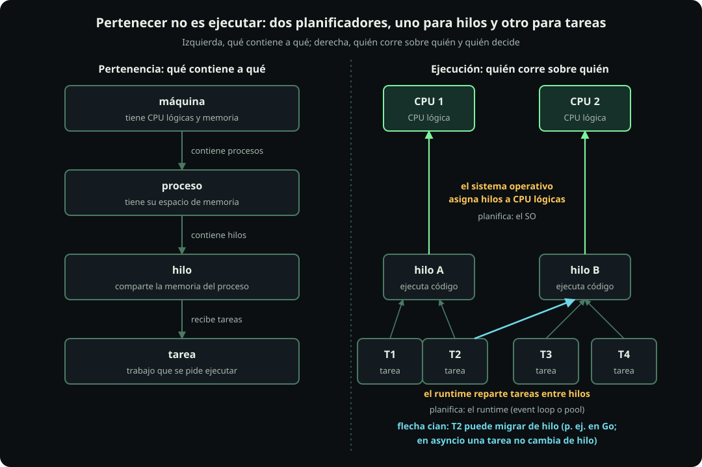
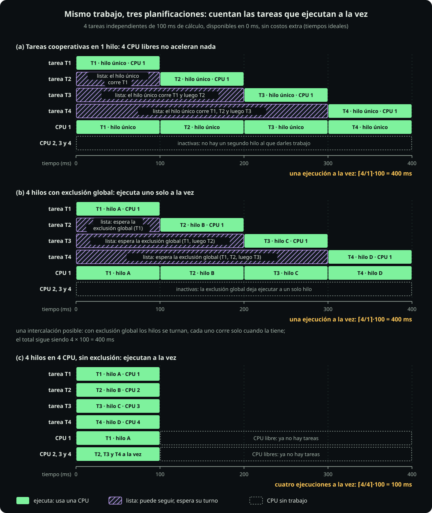

# Capas de ejecución

**Página 10 · Cómputo y concurrencia** · Pregunta: **¿quién ejecuta el trabajo y quién decide su turno?** · Respuesta: **los hilos ejecutan el trabajo. El sistema operativo los asigna a CPU lógicas. El runtime, componente que administra tareas, las reparte entre hilos. El pool puede limitar el paralelismo, pero no lo determina por sí solo.**

Recordatorio ([[secuencial-concurrente-paralelo]]):

- **Proceso.** Un proceso es un programa en ejecución con memoria propia y al menos un hilo.
- **Hilo.** Un hilo es una secuencia de instrucciones. Comparte la memoria del proceso y recibe turnos en una CPU lógica.
- **Tarea.** Una tarea es un flujo secuencial de trabajo. El programa o runtime la administra como unidad.

## A. Quién ejecuta y quién planifica

**Definición.**

| Término | Definición |
|---|---|
| **Runtime** | Un runtime es una biblioteca o programa que reparte tareas entre hilos. `asyncio` cumple esa función con sus tareas. |
| **Planificador** | Un planificador decide qué unidad usa cada recurso en cada instante. Sus turnos aparecen en los diagramas de Gantt. |
| **CPU lógica** | Una CPU lógica es la unidad de ejecución que ve el sistema operativo: un núcleo o hilo del procesador. |
| **Exclusión global** | Una exclusión global permite ejecutar cierto código a un solo hilo. El GIL de CPython, la versión habitual de Python, cumple esa función. |

**Figura.**

::: figure {#cmp-capas title="Pertenecer no es ejecutar: el sistema operativo planifica hilos y el runtime planifica tareas"}

:::

Cómo leerla: cada flecha identifica quién decide una asignación.

**Un caso concreto: `python trabajo.py`.**

1. El sistema operativo crea un proceso, le da memoria y arranca el hilo principal. Ese hilo empieza a ejecutar tu código.
2. Tu código puede pedir más recursos: `threading.Thread` pide un hilo; `ProcessPoolExecutor`, procesos. Python los solicita y el sistema operativo los crea.
3. El sistema operativo mantiene la lista de hilos disponibles y las CPU lógicas libres. Asigna turnos y rota los hilos cuando faltan CPU.
4. Con `asyncio`, un hilo alterna tareas. El sistema operativo solo ve ese hilo.

Chrome suele abrir un proceso por pestaña o sitio. Si una se cuelga, las demás siguen. Un videojuego suele usar un proceso y varios hilos para dibujo, física, sonido y carga. PostgreSQL abre un proceso por conexión ([[componer-un-servidor|página 11]]). Elige procesos para aislar memoria e hilos para compartirla.

**Figura.**

::: figure {#cmp-gantt-tres-planificaciones title="El mismo trabajo tarda 400, 400 o 100 ms según cuántas unidades avanzan a la vez"}

:::

Cómo leerla: sigue cada fila y distingue avance, espera rayada y tiempo total.

**Cuenta.** Supuestos del ejemplo: $n=4$ tareas independientes de $e=100$ ms de cálculo. Todas están disponibles en $t=0$ y no hay costos extra. Son tiempos ideales. Con $p_{\text{ef}}$ unidades que avanzan a la vez:

$$T_{\text{ideal}}=\left\lceil \frac{n}{p_{\text{ef}}}\right\rceil e$$

Regla del ejemplo: $p_{\text{ef}}$ es el menor de tres límites. Estos son las CPU libres, los hilos repartidos y los permitidos por la exclusión global.

Calculado: (a) ejecuta un hilo, así que $p_{\text{ef}}=1$, $\lceil 4/1\rceil\cdot 100=400$ ms. (b) La exclusión global permite uno: $p_{\text{ef}}=1$, $\lceil 4/1\rceil\cdot 100=400$ ms. (c) Hay 4 hilos y 4 CPU libres: $p_{\text{ef}}=4$, $\lceil 4/4\rceil\cdot 100=100$ ms. En (b), hay cuatro hilos y cuatro CPU, pero la exclusión solo permite avanzar a uno.

$p_{\text{ef}}$ depende del trabajo disponible, los recursos físicos, el runtime, las exclusiones y el tamaño del pool. No es una ley general.

**Arquitectura.**

- **Qué es:** el tamaño del pool ayuda a fijar $p_{\text{ef}}$ junto con las CPU, el runtime y las exclusiones.
- **Cuándo sí:** conviene si el pool impone el límite. Por ejemplo, hay 1 hilo y 4 CPU libres sin exclusión global. Esto ocurre con procesos o con una extensión nativa (código compilado, no Python) que suelta esa exclusión.
- **Cuándo no:** no ayuda si otro factor limita a 1. En (b), más hilos no reducen los 400 ms.
- **Qué cuesta:** cada hilo consume memoria y provoca cambios de contexto, momentos cuando la CPU cambia de hilo. El ejemplo ideal omite estos costos.
- **Sistema real:** con el GIL de CPython, un hilo avanza mientras otro espera, pero los hilos no suman cálculo de Python.

Decisión: antes de aumentar un pool, identifica qué factor limita $p_{\text{ef}}$.

## B. Leer una configuración

**Definición.**

| Término | Definición |
|---|---|
| **Paralelismo posible** | Número de unidades que pueden ejecutar simultáneamente según hardware, runtime, exclusiones y configuración. |
| **Tope admitido** | Máximo de tareas que el sistema acepta en curso. |
| **Ocupación** | Fracción del tiempo durante la cual un recurso está en uso. |
| **Rendimiento** | Número de trabajos terminados por unidad de tiempo durante una ventana. |

**Figura.**

| Cantidad | Qué responde | Se lee de | Se obtiene |
|---|---|---|---|
| paralelismo posible | cuántas unidades ejecutan a la vez | hardware, runtime, exclusiones | configuración y documentación |
| tope admitido | cuántas tareas entran en curso | límites del servidor o del pool | configuración |
| ocupación | cuánto se usa un recurso | un recurso, en una ventana | medición |
| rendimiento | cuántos trabajos terminan | una ventana de tiempo | medición |

Cómo leerla: las dos primeras cantidades vienen de la configuración; las otras dos se miden.

**Ejemplo.** Comando `uvicorn app:app --workers 2`, con GIL habilitado y $P=8$ CPU lógicas. Estos son los supuestos del ejemplo. Un worker es un proceso que recibe trabajo; el comando crea 2 procesos worker.

Cada proceso tiene su propio intérprete y GIL. El intérprete ejecuta bytecode, las instrucciones internas que produce Python. Por tanto, como máximo dos hilos ejecutan bytecode simultáneamente: uno por worker. Calculado: paralelismo posible de bytecode = 2, aunque $P=8$.

Este límite no cubre toda la CPU. Una extensión nativa que suelta el GIL puede usar más CPU lógicas. Una operación larga de NumPy puede hacerlo. Sin GIL, el límite no aplica. El comando tampoco fija un tope admitido; `--limit-concurrency` lo fijaría.

**Arquitectura.**

- **Qué es:** el comando permite obtener el paralelismo posible antes de ejecutar el sistema.
- **Cuándo sí:** sirve para elegir workers según $P$ y el cálculo ejecutado en Python.
- **Cuándo no:** no predice la ocupación ni el rendimiento; debes medir ambas cantidades.
- **Qué cuesta:** cada worker duplica la memoria del intérprete y sus pools locales.
- **Sistema real:** en Docker, `--cpus` limita la CPU disponible y `--cpuset-cpus` fija cuáles CPU lógicas usa.

Decisión: el comando da un techo de paralelismo. Si la carga queda debajo, otro factor impone el límite.

## C. Qué hace cada herramienta de Python cuando paralelizas

**Definición.** **Paralelizar** es repartir trabajo entre unidades que avanzan simultáneamente en CPU distintas. Cada herramienta de Python lo logra de forma diferente.

**Figura (tabla).**

| Herramienta | ¿Cuántos procesos? | ¿Usa varias CPU para calcular? | Qué está haciendo |
|---|---|---|---|
| `threading`, `ThreadPoolExecutor` | 1 | No: un solo hilo ejecuta Python a la vez (GIL) | Reparte tareas entre hilos del mismo proceso; mientras uno espera la red, otro avanza |
| `asyncio` | 1 | No: un hilo, una CPU | Un hilo alterna tareas; combina esperas, pero no calcula en paralelo |
| `multiprocessing`, `ProcessPoolExecutor` | varios, uno por trabajador | Sí | Arranca procesos con intérprete y GIL propios; copia los datos a cada proceso |
| `joblib.Parallel` con `n_jobs` > 1 | varios, por omisión | Sí | Reparte tareas entre procesos mediante el backend `loky`, su mecanismo interno; si lo pides, usa hilos |
| NumPy, Polars ([[vectorizar]]) | 1 | Sí, dentro de una operación | Una llamada usa código nativo que suelta el GIL y puede iniciar varios hilos propios |
| Python sin GIL (3.13, opcional) | 1 | Sí, también con hilos | Varios hilos ejecutan Python simultáneamente sin candado global |

**Ejemplo.** Considera las 4 tareas de 100 ms del Gantt. Con `ThreadPoolExecutor(4)` ocurre (b): 400 ms, porque solo ejecuta un hilo. Con `ProcessPoolExecutor(4)` ocurre (c): cerca de 100 ms, más el costo de iniciar procesos y copiar datos ([[calcular-en-paralelo]]). Si `top` muestra 4 CPU al 100 %, hay 4 procesos o código nativo con varios hilos. No son 4 hilos de Python.

**Arquitectura.**

- **Qué es:** elige la herramienta según el factor que limita el trabajo.
- **Cuándo sí:** usa hilos o `asyncio` para esperas. Usa procesos para cálculo en Python y NumPy o Polars para arreglos.
- **Cuándo no:** evita procesos si las tareas duran menos que su costo de arranque y copia.
- **Qué cuesta:** cada proceso duplica la memoria del intérprete y los datos recibidos.
- **Sistema real:** scikit-learn y otras bibliotecas usan `joblib` cuando aceptan `n_jobs`.

Decisión: antes de usar procesos, comprueba que el trabajo calcula en Python y dura más que su reparto.

## Si hay tiempo

Otros lenguajes reparten el trabajo de otras formas.

| Lenguaje | ¿Usa varias CPU? | En palabras simples |
|---|---|---|
| Go | Sí, por omisión | Las *goroutines* son tareas muy ligeras de Go. El runtime las reparte entre hilos. `GOMAXPROCS` fija cuántas ejecutan simultáneamente, no cuántas existen |
| Elixir y Erlang (BEAM) | Sí, por omisión | BEAM ejecuta estos lenguajes. Sus «procesos» son tareas muy ligeras, no procesos del sistema. Por omisión, usa un planificador por CPU lógica; `+S` lo cambia |
| Node.js | No para tu código | Un hilo ejecuta JavaScript y el sistema espera la red. Archivos y DNS usan 4 hilos internos. DNS busca la dirección de red de un nombre. Para más CPU: `worker_threads` o varios procesos |
| Java | Sí | Los hilos normales pertenecen al sistema. Los virtuales son ligeros y usan pocos hilos del sistema, llamados «portadores». No crean CPU nuevas |

## Notebook

- Celda 10.1, parte de hilos: lanza 4 hilos. Cada uno imprime el PID, número que identifica al proceso, y su hilo. Salida esperada: un solo PID repetido y cuatro nombres de hilo distintos.
- Celda 10.1, parte de procesos: lanza 2 procesos y cada uno imprime su PID. Salida esperada: dos PID distintos.
