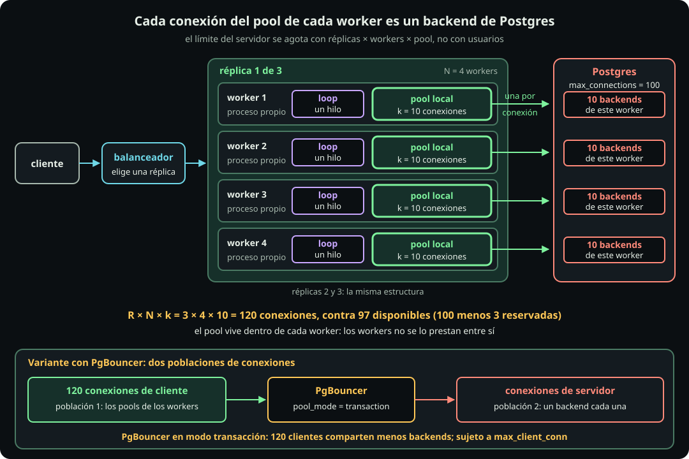
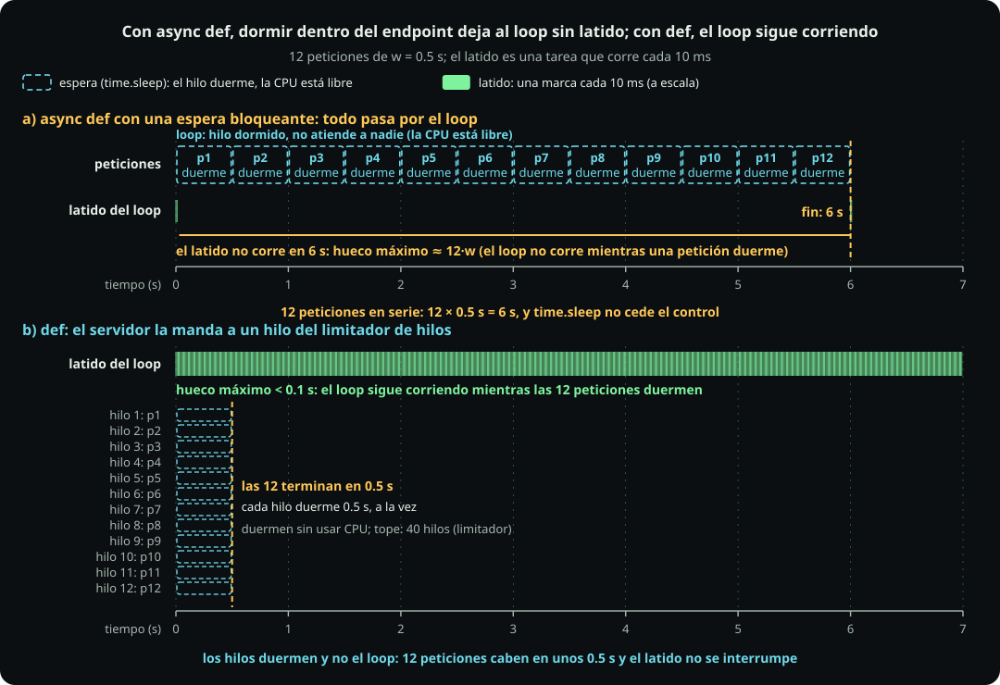

# Componer un servidor

**Página 11 · Cómputo y concurrencia** · Pregunta: **de una configuración, ¿cuántos procesos, hilos y conexiones resultan?** · Respuesta: **cada worker crea su pool local; `async def` corre en el loop, `def` en hilos, y los topes locales se multiplican.**

Un **proceso** es un programa en ejecución con memoria propia y al menos un hilo. $N$ representa los trabajadores y $k$ el tope real de permisos, conexiones o procesos, como en [[notacion-computo]]. Consulta el dimensionamiento en [[pools-y-recursos]].

## A. El pool local de cada worker

**Términos.**

| Término | Definición |
|---|---|
| Worker | Un **worker** es un proceso que atiende peticiones con su propio loop o hilos. |
| Réplica | Una **réplica** es una copia del servicio en otra máquina o contenedor. |
| Balanceador | Un **balanceador** es el programa que reparte las peticiones entre las réplicas. |
| Backend | Un **backend** de Postgres es el proceso del servidor que atiende una conexión. |

**Definición.** Un **pool local** es el conjunto de conexiones que crea y usa un worker.

**Figura.**

::: figure {#cmp-ancla-servidor title="Cada worker tiene su loop y su pool; cada conexión directa es un backend de Postgres"}

:::

Cómo leerla: cuenta el pool resaltado. Con PgBouncer, separa los clientes al pooler de sus conexiones a Postgres.

**Cuenta.** Conexiones abiertas, consultas activas y CPU usada son cantidades distintas. En Postgres, cada conexión directa tiene un backend propio, aunque esté ociosa. Una consulta puede usar varios trabajadores paralelos del servidor. Ninguna cifra se deduce de otra.

**Ejemplo.** Un pool de 10 conexiones abiertas, con 2 ejecutando consultas, produce 10 backends y 2 consultas activas (supuesto del ejemplo).

**Arquitectura.**

- **Qué es:** la propiedad del pool es local al proceso.
- **Cuándo sí:** el worker es el dueño único de sus conexiones.
- **Cuándo no:** no supongas que un pool se comparte entre procesos; entre hilos depende de la biblioteca.
- **Qué cuesta:** cada worker suma su pool a la cuenta del servidor.
- **Sistema real:** Postgres crea un backend por conexión directa. PgBouncer, en modo transacción, comparte menos backends entre más clientes, sujeto a su propio `max_client_conn`.

Decisión: suma los pools de todos los workers al dimensionar el servidor.

## B. `async def` y `def`

**Términos.**

| Término | Definición |
|---|---|
| Loop | El **loop** es el hilo que ejecuta las tareas asíncronas por turnos. |
| Latido | El **latido** es una tarea de prueba del servidor: cada 10 ms pide que la despierten y anota cuánto tardó en recibir turno. |
| AnyIO | **AnyIO** es la biblioteca que Starlette, la base de FastAPI, usa para correr funciones síncronas en hilos. |
| Desplazar | **Desplazar** es ejecutar trabajo bloqueante fuera del loop, en un hilo. |
| Limitador de hilos | El **limitador de hilos** topa las funciones síncronas; AnyIO ofrece $k_h=40$ **tokens** por loop, configurables y compartidos; cada token permite un hilo. |

**Definición.** FastAPI ejecuta un endpoint `async def` en el **loop** y un endpoint `def` en hilos del **limitador**. La forma de la función determina el lugar.

**Figura.**

::: figure {#cmp-async-vs-def title="Con async def la espera bloqueante detiene al loop; con def corre en hilos"}

:::

Cómo leerla: compara las 12 esperas en fila y el hueco de unos 6 s con 12 hilos y un latido continuo.

**Cuenta.** Con $n$ solicitudes simultáneas de espera $w$ y $k_h$ tokens del limitador:

$$T_{\text{async}} \approx n\,w, \qquad T_{\text{def}} \approx \left\lceil \frac{n}{k_h} \right\rceil w.$$

Con $n=12$, $w=0{,}5$ s y $k_h=40$: $T_{\text{async}} \approx 12 \cdot 0{,}5 = 6$ s y $T_{\text{def}} \approx \lceil 12/40 \rceil \cdot 0{,}5 = 0{,}5$ s (calculados, aproximaciones). En `async def` se bloquea el loop, no la CPU: el hilo duerme y nada más corre allí. Esto vale solo si la espera bloquea (`time.sleep`); con `await asyncio.sleep`, el loop atendería las 12 a la vez.

**Ejemplo (D1, celda 11.1).** Parámetros: un worker, 12 solicitudes simultáneas que duermen $w=0{,}5$ s con `time.sleep`, y al menos 12 tokens. Para comprobar que el loop quedó bloqueado, el servidor usa un **latido**:

1. Agrega al loop una tarea más, el latido: hace `await asyncio.sleep(0.01)` y, al despertar, anota cuánto tiempo pasó desde la vez anterior. Ese tiempo es el **hueco**.
2. Con el loop libre, el latido recibe turno en cuanto vence su espera de 10 ms: el hueco es de unos 10 ms.
3. Con `async def`, cada petición hace `time.sleep(0.5)` sin `await`: el hilo del loop duerme y no cede el turno. El latido ya cumplió sus 10 ms, así que está **lista** (como en los Gantt: puede avanzar y no tiene turno) y espera.
4. El loop pasa de una petición a la siguiente sin dejar turno al latido, que no corre hasta que terminan las 12: hueco $\approx 12\cdot0{,}5=6$ s.
5. Con `def`, el `sleep` ocurre en hilos aparte, el loop sigue libre y el latido corre cada 10 ms.

El hueco máximo mide, entonces, cuánto tiempo estuvo el loop sin atender a nadie. Medido en 8 CPU: con `async def`, las 12 tardan 6.02 s y el hueco máximo es 5.51 s; con `def`, tardan 0.53 s y el hueco máximo es 0.02 s.

**Arquitectura.**

- **Qué es:** desplazar `def` consume el limitador compartido.
- **Cuándo sí:** usa `async def` con `await` y `def` con llamadas bloqueantes.
- **Cuándo no:** un `def` llamado directamente desde un `async def` no se desplaza y bloquea el loop.
- **Qué cuesta:** cada llamada desplazada con AnyIO ocupa un token mientras se espera su terminación; los hilos ociosos y otros executors no cuentan, y las llamadas que exceden los tokens esperan.
- **Sistema real:** FastAPI, mediante Starlette, usa AnyIO sobre uvicorn.

Decisión: elige `async def` para trabajo con `await` y `def` para llamadas bloqueantes.

## C. Presupuesto de conexiones

**Definición.** El **presupuesto de conexiones** es el máximo permitido contra un servidor: $R\times N\times k$, con $R$ réplicas, $N$ workers por réplica y $k$ conexiones máximas por pool.

**Figura (tabla).** Los valores son supuestos del ejemplo; el servidor es el mismo para todas.

| Concepto | Símbolo | Valor | Naturaleza |
|---|---|---|---|
| Réplicas | $R$ | 3 | supuesto |
| Workers por réplica | $N$ | 4 | supuesto |
| Máximo por pool | $k$ | 10 | supuesto |
| `max_connections` de Postgres | | 100 | supuesto (valor frecuente) |
| Plazas de superusuario | | 3 | supuesto |

**Cuenta.**

$$R\times N\times k = 3\times 4\times 10 = 120 \quad\text{frente a}\quad 100-3 = 97.$$

Los 120 valen si 10 es el máximo total por pool y todas las conexiones van al mismo servidor. Son capacidad potencial, no conexiones ya abiertas. Las 97 suponen `reserved_connections=0`; otros consumidores las reducen y `SHOW max_connections` las comprueba. Un pico que llene todos los pools excede 97 por 23 (calculado).

**Arquitectura.**

- **Qué es:** agrega los topes locales de réplicas, workers y pools.
- **Cuándo sí:** calcúlalo antes de cambiar $R$, $N$ o $k$.
- **Cuándo no:** no estima consultas activas ni CPU.
- **Qué cuesta:** escalar réplicas multiplica la presión sobre la base de datos, aunque cada pool no cambie ([[arquitectura-y-estrategia]]).
- **Sistema real:** Postgres limita conexiones con `max_connections`; usa PgBouncer si la cuenta supera al servidor.

Decisión: compara $R\times N\times k$ con la capacidad disponible antes de escalar el servicio.

## Si hay tiempo

Con PgBouncer, el tope del lado cliente y el del lado servidor son dos números separados.

## Notebook

- Celda 11.1: lanza `app_arq.py` con uvicorn en un subproceso (un worker); envía 12 peticiones a `/async-bloqueante` y después a `/def-bloqueante`; imprime el total y el hueco máximo del latido (`/latido`) en cada caso, con $T_{\text{async}}$ cerca de 6 s y $T_{\text{def}}$ cerca de 0.5 s.
- Celda 11.2: calcula $R\times N\times k$ con $R=3$, $N=4$, $k=10$ y lo compara con 97; imprime 120 y el exceso de 23.
