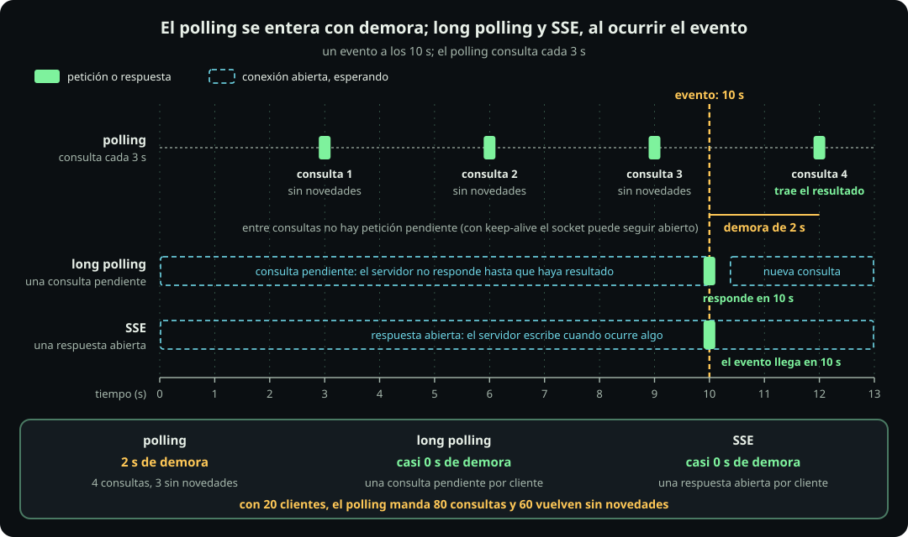
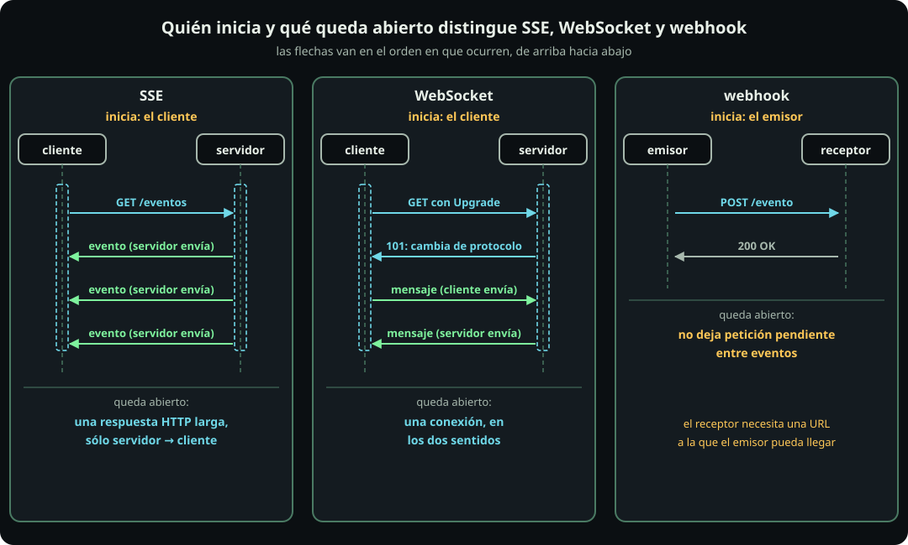

# Cómo llegan los resultados

**Página 12 · Cómputo y concurrencia** · Pregunta: **si la respuesta no está lista cuando preguntas, ¿cómo te enteras?** · Respuesta: **pregunta mediante polling o long polling, o recibe un aviso mediante SSE, WebSocket o webhook. Cada opción cambia las peticiones, la demora y los recursos retenidos.**

Una **tarea** es un flujo secuencial de trabajo que un runtime o el programa trata como unidad.

## A. Preguntar

**Definición.**

- El **polling** repite una petición cada $\Delta$ segundos.
- El **long polling** retiene una consulta hasta que haya una novedad o venza un plazo.
- Una **conexión** es un canal abierto entre dos programas; su extremo en cada programa es un **socket**.
- **Keep-alive** reutiliza una misma conexión HTTP para varias peticiones.

**Figura.** Un mismo evento, tres formas de enterarse.

::: figure {#cmp-gantt-resultados title="El polling se entera en la siguiente consulta; long polling y SSE, al ocurrir el evento"}

Cómo leerla: cada barra representa una conexión o consulta; el rombo marca el evento.
:::

**Cuenta.** Sea $T_{\text{evt}}$ el instante del evento y $\Delta$ el intervalo. La primera consulta ocurre en $\Delta$, sin consulta inicial. Suponemos relojes monotónicos sin deriva:

$$\text{sin novedades}=\left\lceil \tfrac{T_{\text{evt}}}{\Delta}\right\rceil-1,\qquad \text{totales}=\left\lceil \tfrac{T_{\text{evt}}}{\Delta}\right\rceil,\qquad \text{demora}=\Delta\left\lceil \tfrac{T_{\text{evt}}}{\Delta}\right\rceil-T_{\text{evt}}$$

Con $T_{\text{evt}}=10$ s y $\Delta=3$ s (parámetros del ejemplo), $\lceil 10/3\rceil=4$. Las consultas ocurren en 3, 6, 9 y 12 s: tres llegan sin novedades, cuatro son totales y la demora es $12-10=2$ s. El ejemplo es determinista; la media $\Delta/2$ exige una fase uniforme. Con 20 clientes que arrancan en $t=0$ (supuesto; se desprecian red y procesamiento): 60 sin novedades y 80 totales.

**Ejemplo.** La celda 12.1 lanza 20 clientes por modalidad contra `/listo` (polling), `/espera` (long polling) y `/eventos` (SSE) de `app_arq.py`, con un worker. El evento ocurre a los 10 s después de llamar a `/inicia`. Los intervalos se miden con reloj monotónico. Medido en 8 CPU: los 20 clientes de polling hicieron 80 consultas (calculado: 80), con demora 2.03 s. Long polling y SSE se enteraron con demora 0.05 s cada uno. Conexiones y peticiones se miden por separado porque representan recursos distintos. Polling con keep-alive conservó 20 sockets abiertos, aunque casi ninguna petición quedó pendiente. Long polling mantuvo 20 peticiones pendientes.

**Arquitectura.**

- **Qué es:** polling pregunta periódicamente; long polling espera en una consulta.
- **Cuándo sí:** usa polling si toleras la demora $\Delta$ y el servidor no puede retener conexiones. Esto ocurre con pocos clientes o proxies que cortan conexiones abiertas. Usa long polling si necesitas baja demora sin un protocolo de canal dedicado.
- **Cuándo no:** evita polling con muchos clientes y eventos raros, porque casi todas las consultas llegan sin novedades.
- **Qué cuesta:** reducir $\Delta$ baja la demora, pero aumenta las peticiones inútiles. Long polling mantiene una petición pendiente por cliente.
- **Sistema real:** una API de trabajos asíncronos devuelve un identificador que el cliente consulta.

Decisión: usa polling si toleras $\Delta$; usa long polling si necesitas baja demora sin un protocolo de canal dedicado.

## B. Que te avisen

**Definición.**

- **SSE** es una respuesta HTTP continua que envía eventos del servidor al cliente.
- Un **stream** es una respuesta que continúa enviando datos por la misma conexión.
- Un **WebSocket** es un canal bidireccional que el cliente establece sobre HTTP.
- Un **webhook** es un mecanismo donde el emisor del evento llama al receptor registrado.

**Figura.** Quién inicia y qué queda abierto.

::: figure {#cmp-push-webhook title="SSE y WebSocket los inicia el cliente y dejan una conexión abierta; el webhook lo inicia el emisor y no deja ninguna petición pendiente entre eventos"}

Cómo leerla: la flecha de apertura marca quién inicia; la línea continua indica qué queda abierto.
:::

| Mecanismo | Quién inicia | Qué queda abierto | Recurso retenido y unidad que ejecuta | Falla típica |
|---|---|---|---|---|
| SSE | el cliente | una respuesta HTTP | una sesión por cliente (en HTTP/1.1, también una conexión; HTTP/2 admite varias sesiones por conexión); hilo o tarea, según el manejador | cliente lento: el servidor acumula envíos pendientes; al reconectar, el cliente manda `Last-Event-ID` y el servidor reanuda solo si emitió `id:` y conserva los eventos |
| WebSocket | el cliente | un canal bidireccional | igual que SSE | cliente lento |
| webhook | el emisor | ninguna petición pendiente entre eventos (puede conservarse una conexión keep-alive) | ninguna petición pendiente entre eventos | el emisor no puede acceder al receptor |

**Cuenta.** Por la ley de Little ([[arquitectura-y-estrategia]]), el promedio de sesiones abiertas $L$ es la tasa de aperturas $\lambda$ por su duración media $W$:

$$L=\lambda W$$

La cuenta exige régimen estable o la contabilidad completa de una ventana finita. Una corrida aislada no demuestra estabilidad. Además, $L$ es un promedio, no el máximo instantáneo. Con 5 aperturas por segundo y 40 s de duración media (supuestos del ejemplo): $L=5\times40=200$ sesiones. En D2, medido, hubo `20` sesiones SSE abiertas con 20 clientes.

**Arquitectura.**

- **Qué es:** SSE y WebSocket mantienen una conexión iniciada por el cliente; un webhook envía una petición desde el emisor.
- **Cuándo sí:** usa SSE para un flujo solo del servidor al cliente. Usa WebSocket si el cliente también envía continuamente. Usa webhook entre servicios cuando el receptor tiene una dirección accesible.
- **Cuándo no:** evita SSE o WebSocket si el servidor no puede sostener tantas conexiones abiertas como $L$. Evita webhook si el emisor no puede acceder al receptor.
- **Qué cuesta:** SSE y WebSocket retienen una conexión y memoria por sesión. Un webhook exige idempotencia para tolerar duplicados. El manejador decide si cada sesión retiene un hilo o una tarea (ver [[asincrono-y-el-event-loop]]). Acota las sesiones como en [[concurrencia-acotada]].
- **Sistema real:** notificaciones de pago por webhook; tableros en vivo por SSE.

Decisión: usa SSE para servidor→cliente, WebSocket para comunicación bidireccional y webhook entre servicios con un receptor accesible.

## Si hay tiempo

- **gRPC, GraphQL y SOAP** describen el contrato entre cliente y servidor, no un patrón equivalente a polling.
- **gRPC** admite llamadas unarias y tres variantes de streaming: del servidor, del cliente y bidireccional.
- **GraphQL** permite elegir los campos de la respuesta; sus suscripciones usan un canal como WebSocket o SSE.

## Notebook

- **Celda 12.1:** arranca `app_arq.py`, llama a `/inicia` y ejecuta 20 clientes por modalidad contra `/listo`, `/espera` y `/eventos`. Imprime consultas, demora, sockets abiertos, peticiones pendientes y sesiones SSE, con el evento a 10 s.
