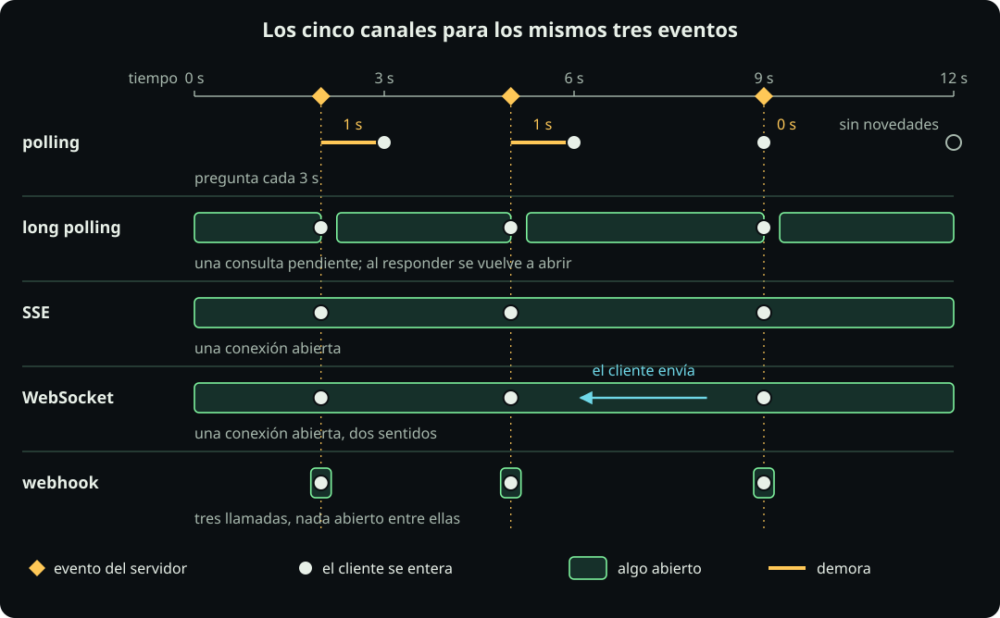
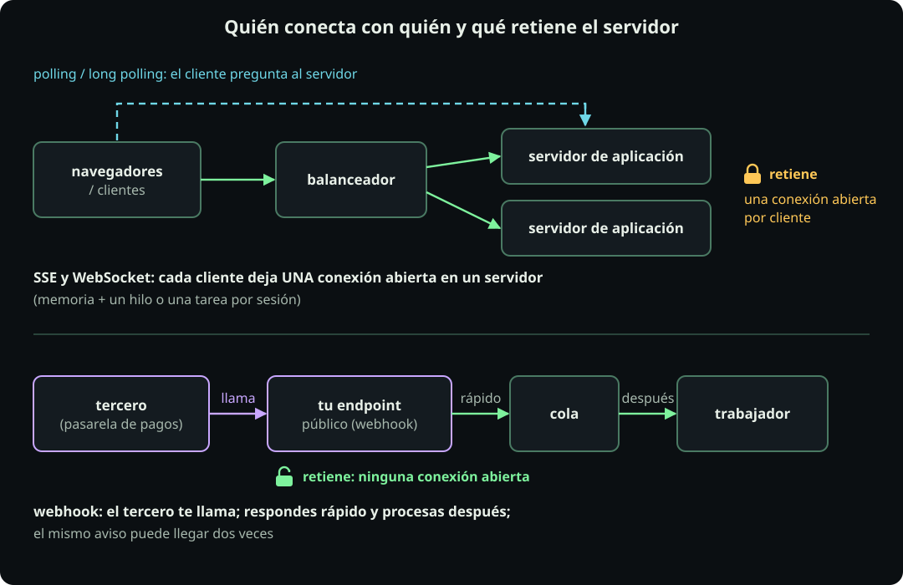
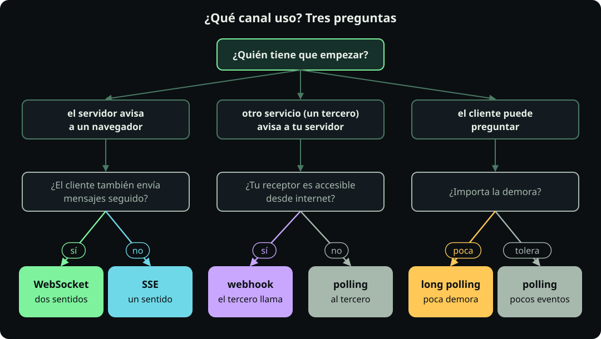

# Cómo llegan los resultados

**Página 12 · Cómputo y concurrencia** · Pregunta: **si la respuesta no está lista, ¿cómo te enteras?** · Respuesta: **preguntas mediante polling o long polling, o recibes un aviso mediante SSE, WebSocket o webhook.**

Cada opción cambia las peticiones, la demora y los recursos retenidos.

Una **tarea** es un flujo secuencial tratado como unidad por el programa o runtime.

## A. Preguntar

**Definición.**

- El **polling** repite una petición cada $\Delta$ segundos.
- El **long polling** retiene una consulta hasta recibir una novedad o vencer un plazo.
- Una **conexión** es un canal abierto entre programas; cada extremo usa un **socket** para enviar y recibir.
- **Keep-alive** conserva la conexión después de responder y evita abrir otra para la siguiente petición.

**Figura.** Un mismo evento, tres formas de enterarse.

::: figure {#cmp-gantt-resultados title="El polling se entera en la siguiente consulta; long polling y SSE, al ocurrir el evento"}

Cómo leerla: cada barra representa una conexión o consulta; el rombo marca el evento.
:::

**Cuenta.** Con dos datos calculas consultas totales, consultas sin novedades y demora.

::: definition {#cmp-def-polling title="Consultas y demora del polling"}
**Qué dice.** El cliente consulta cada $\Delta$ segundos, comenzando en $\Delta$. Se entera en la primera consulta posterior o simultánea al evento.

**Variables.**

- $T_{\text{evt}}$: instante del evento desde el inicio, en segundos.
- $\Delta$: intervalo entre consultas, en segundos; la primera ocurre en $\Delta$, sin consulta inicial.
- $\text{totales}$: consultas hasta recibir la novedad, sin unidad.
- $\text{sin novedades}$: consultas anteriores al evento, sin unidad.
- $\text{demora}$: tiempo entre el evento y su detección, en segundos.

**Fórmulas.**

$$\text{totales}=\left\lceil \frac{T_{\text{evt}}}{\Delta}\right\rceil,\qquad \text{sin novedades}=\left\lceil \frac{T_{\text{evt}}}{\Delta}\right\rceil-1,\qquad \text{demora}=\Delta\left\lceil \frac{T_{\text{evt}}}{\Delta}\right\rceil-T_{\text{evt}}$$

**Por qué es así.**

- Las consultas ocurren en $\Delta,2\Delta,3\Delta,\ldots$; la consulta $j$ cae en $j\Delta$.
- Buscamos la primera $j$ con $j\Delta\ge T_{\text{evt}}$; el techo entrega ese entero. Un múltiplo exacto ve el evento.
- Las anteriores no traen novedades. La demora resta el instante del evento al de la última consulta.
:::

**Ejemplo paso a paso.**

1. **Datos.** $T_{\text{evt}}=10$ s y $\Delta=3$ s (parámetros del ejemplo).
2. **Techo.** $10/3=3.33\ldots$ y $\lceil 3.33\ldots\rceil=4$.
3. **Instantes.** Las consultas ocurren en 3, 6, 9 y 12 s.
4. **Totales y sin novedades.** Totales: 4. Sin novedades: $4-1=3$, en 3, 6 y 9 s.
5. **Demora.** $3\times4-10=2$ s, entre el evento de 10 s y la consulta de 12 s.
6. **Con 20 clientes.** Todos arrancan en $t=0$ (supuesto). Totales: $20\times4=80$. Sin novedades: $20\times3=60$.
7. **Lectura.** De 80 consultas, 60 llegaron sin novedades. Cada cliente esperó 2 s adicionales.

**Ejemplo medido.** La celda 12.1 lanza 20 clientes por modalidad contra `app_arq.py`, con un worker. Usa `/listo`, `/espera` y `/eventos`. El evento ocurre 10 s después de llamar a `/inicia`.

Los intervalos usan un reloj monotónico. Medido en 8 CPU, polling hizo 80 consultas (calculado: 80) y demoró 2.03 s. Long polling y SSE demoraron 0.05 s cada uno.

Conexiones y peticiones se miden por separado porque representan recursos distintos. Polling con keep-alive conservó 20 sockets abiertos. Casi ninguna petición quedó pendiente. Long polling mantuvo 20 peticiones pendientes.

**Arquitectura.**

- **Qué es:** polling pregunta periódicamente; long polling espera dentro de una consulta.
- **Cuándo sí:** usa polling si toleras $\Delta$, tienes pocos clientes o los proxies cortan conexiones. Usa long polling para menor demora.
- **Cuándo no:** evita polling con muchos clientes y eventos raros; casi todas las consultas llegarán sin novedades.
- **Qué cuesta:** reducir $\Delta$ aumenta las peticiones inútiles. Long polling retiene una petición por cliente.
- **Sistema real:** una API asíncrona devuelve un identificador que el cliente consulta.

Decisión: usa polling si toleras $\Delta$; usa long polling si necesitas menor demora sin un canal dedicado.

## B. Que te avisen

**Definición.**

- **SSE** es una respuesta HTTP continua que envía eventos del servidor al cliente.
- Un **stream** continúa enviando datos mediante la misma conexión.
- Un **WebSocket** es un canal bidireccional establecido por el cliente sobre HTTP.
- Un **webhook** permite que el emisor del evento llame al receptor registrado.

**Figura.** Quién inicia y qué queda abierto.

::: figure {#cmp-push-webhook title="SSE y WebSocket los inicia el cliente y dejan una conexión abierta; el webhook lo inicia el emisor y no deja ninguna petición pendiente entre eventos"}

Cómo leerla: la flecha marca quién inicia; la línea continua indica qué queda abierto.
:::

| Mecanismo | Quién inicia | Qué queda abierto | Recurso retenido y unidad que ejecuta | Falla típica |
|---|---|---|---|---|
| SSE | cliente | respuesta HTTP | sesión por cliente; hilo o tarea | cliente lento: acumula envíos |
| WebSocket | cliente | canal bidireccional | igual que SSE | cliente lento |
| webhook | emisor | ninguna petición entre eventos; quizá keep-alive | ninguna petición entre eventos | receptor inaccesible |

**Cuenta.** La ley de Little calcula las sesiones abiertas simultáneamente ([[arquitectura-y-estrategia]]).

::: definition {#cmp-def-little-sesiones title="Ley de Little para sesiones abiertas"}
**Qué dice.** El promedio de sesiones abiertas multiplica la rapidez de apertura por su duración media.

**Variables.**

- $L$: sesiones abiertas en promedio, en sesiones.
- $\lambda$: rapidez de apertura, en sesiones/s.
- $W$: duración media desde apertura hasta cierre, en segundos.

**Fórmula.**

$$L=\lambda W$$

**Por qué es así.**

- Cada segundo entran $\lambda$ sesiones. Tras $W$ segundos, siguen abiertas las llegadas durante ese periodo: $\lambda\times W$.
- Requiere régimen estable, igual población y misma frontera. Una corrida aislada no demuestra estabilidad.
- $L$ es un promedio, no un máximo; planea con margen.
:::

**Ejemplo paso a paso.**

1. **Datos (supuestos del ejemplo, no medidos).** $\lambda=5$ sesiones/s y $W=40$ s.
2. **Cuenta.** $L=5\times40=200$ sesiones abiertas en promedio.
3. **Segunda situación.** Hay 2000 clientes simultáneos: $L=2000$. Con $W=40$ s, $\lambda=L/W=2000/40=50$ aperturas/s.
4. **Lectura.** El servidor sostiene 200 sesiones en el primer caso y 2000 en el segundo.
5. **Medido.** En D2 hubo `20` sesiones SSE abiertas con 20 clientes.

**Arquitectura.**

- **Qué es:** SSE y WebSocket conservan una conexión del cliente; webhook envía una petición desde el emisor.
- **Cuándo sí:** usa SSE para servidor→cliente, WebSocket para tráfico bidireccional y webhook cuando el receptor sea accesible.
- **Cuándo no:** evita SSE o WebSocket si no puedes sostener $L$. Evita webhook con un receptor inaccesible.
- **Qué cuesta:** cada sesión retiene conexión y memoria. Webhook exige idempotencia. El manejador retiene un hilo o una tarea.
- **Sistema real:** pagos notifican por webhook; tableros en vivo usan SSE.

Consulta [[asincrono-y-el-event-loop]] para hilos y tareas. Acota las sesiones como en [[concurrencia-acotada]].

Decisión: usa SSE para servidor→cliente, WebSocket para comunicación bidireccional y webhook entre servicios con receptor accesible.

## C. Elegir el canal

**Definición.** Un **canal** es cómo recibes resultados; elegirlo decide quién empieza, qué queda abierto y qué retiene el servidor.

**Idea y conclusión.**

- Preguntar periódicamente puede demorar la detección; con avisos, el servidor envía cuando tiene novedades.
- Polling pregunta cada cierto tiempo y no deja nada pendiente; long polling deja una petición esperando por cliente.
- SSE y WebSocket retienen sesiones y memoria; el navegador abre primero.
- Webhook no necesita peticiones pendientes entre avisos; debes reconocer eventos duplicados.
- **Conclusión:** elige por quién debe empezar y cuántos clientes atenderás, no por moda.

**Figura.**

::: figure {#cmp-canales-eventos title="Los cinco canales para los mismos tres eventos"}

:::

Cómo leerla: compara cuándo ocurre cada evento y cuándo llega; se omiten las demoras de red y procesamiento.

**Figura.** Un **balanceador** reparte conexiones entre servidores; un **endpoint** es una dirección donde un servidor recibe peticiones.

::: figure {#cmp-canales-arquitectura title="Quién conecta con quién y qué retiene el servidor"}

:::

Cómo leerla: cada sesión ocupa memoria; el dibujo supone una conexión por cliente. HTTP/2 permite compartir conexiones entre sesiones SSE del mismo navegador.

| Canal | Úsalo cuando | Evítalo cuando | Ejemplo real | Frente a los otros |
|---|---|---|---|---|
| Polling | Buscas sencillez y toleras demora; funciona donde puedas hacer peticiones HTTP. | Muchos clientes consultan frecuentemente o casi nunca hay novedades. | Estado de una exportación. | Frente a long polling, no mantiene una consulta esperando novedades. |
| Long polling | Necesitas baja demora sin cambiar HTTP; retiene una petición pendiente por cliente. | Los proxies, intermediarios HTTP, [cortan la espera antes de tu plazo](https://www.rfc-editor.org/rfc/rfc6202.html#section-5.5). | Llegada de mensajes. | Frente a SSE, renuevas la petición después de cada respuesta. |
| SSE | Solo necesitas avisos del servidor por HTTP; el navegador intenta reconectar automáticamente con su receptor SSE. | Necesitas muchas pestañas en HTTP/1.1: [el navegador suele limitar a seis conexiones por dominio](https://developer.mozilla.org/en-US/docs/Web/API/Server-sent_events/Using_server-sent_events). | Avance de una exportación. | Frente a WebSocket, simplifica recibir avisos sin enviar mensajes por ese canal. |
| WebSocket | Ambos lados envían mensajes frecuentes. | No puedes gestionar reconexión y [configurar el balanceador para WebSocket](https://nginx.org/en/docs/http/websocket.html). | Edición colaborativa de documentos. | Frente a SSE, admite mensajes en ambos sentidos. |
| Webhook | Otro servicio ofrece avisos hacia tu endpoint público. | No puedes responder rápido, verificar al emisor o tolerar avisos duplicados. | [Confirmación de pagos de Stripe](https://docs.stripe.com/webhooks). | Frente a polling, el proveedor avisa sin consultas periódicas. |

Para webhooks, guarda el aviso antes de responder; procesa después. Sé **idempotente**: recibir dos veces el mismo aviso debe producir el mismo efecto que recibirlo una vez.

**Costo.** Cada canal le cuesta algo distinto al servidor: peticiones, conexiones abiertas o llamadas.

::: definition {#cmp-def-costo-canales title="Costo de cada canal con muchos clientes"}
**Qué dice.** Polling cuesta **peticiones por segundo**, aunque no haya novedades. Long polling, SSE y WebSocket cuestan **conexiones abiertas**. Webhook cuesta **una llamada por evento** y nada abierto.

**Variables.**

- $n_{\text{cli}}$: clientes que esperan a la vez (clientes).
- $\Delta$: segundos entre consultas del polling (s).

**Fórmulas.**

$$\text{polling}=\frac{n_{\text{cli}}}{\Delta}\ \text{consultas/s},\qquad \text{long polling, SSE, WebSocket}=n_{\text{cli}}\ \text{conexiones abiertas}$$

**Por qué es así.**

- En polling cada cliente consulta una vez cada $\Delta$ segundos; entre todos son $n_{\text{cli}}/\Delta$ por segundo, haya o no novedades.
- En los otros tres cada cliente deja una conexión abierta mientras espera: son $n_{\text{cli}}$ a la vez (es la ley de Little de arriba).
- En webhook el emisor llama solo cuando hay un evento: no hay consultas vacías ni conexiones abiertas.
:::

**Ejemplo paso a paso.**

1. **Datos.** $n_{\text{cli}}=10\,000$ clientes, $\Delta=5$ s y un evento por cliente cada 10 minutos (supuestos).
2. **Polling.** $10\,000/5=2\,000$ consultas por segundo.
3. **Cuántas sirven.** Cada cliente hace $600/5=120$ consultas por evento: 119 llegan vacías, o sea 99 %.
4. **SSE.** $10\,000$ conexiones abiertas y casi ninguna consulta.
5. **Lectura.** Polling gasta peticiones; SSE gasta memoria y sesiones. Elige lo que tu servidor sostenga mejor: 2 000 consultas por segundo o 10 000 conexiones abiertas.

**Mal elegido.**

- Polling cada segundo, 10 000 clientes y eventos raros: miles de consultas por segundo casi siempre vacías. Usa SSE si necesitas avisos rápidos y puedes sostener esas sesiones.
- Esperar el cobro de Stripe por WebSocket deja tu servidor sin ese aviso; usa su webhook.
- Webhook hacia un navegador: no ofrece un endpoint público y el aviso no llega. Recíbelo en tu servidor y avisa mediante SSE.

**Figura.**

::: figure {#cmp-canales-decision title="¿Qué canal uso? Tres preguntas"}

:::

Cómo leerla: identifica quién debe enviar la novedad; después decide si necesitas enviar seguido o cuánto puedes esperar.

**Resumen para decidir.**

- Servidor → navegador: SSE; ambos envían seguido → WebSocket. El navegador abre primero.
- Tercero → servidor público: webhook; cliente pregunta: long polling con poca demora, polling si toleras esperar.
- Con SSE o WebSocket, más clientes simultáneos implican más sesiones retenidas. Cuenta las sesiones con la ley de Little de la caja anterior.
- Si dudas, empieza con polling para pocos clientes; mide demora y consultas vacías.

## Si hay tiempo

- **Detalles que las cuentas omiten:** la demora media es $\Delta/2$ solo con eventos aleatorios entre consultas; suponen relojes monotónicos sin deriva.
- Con HTTP/2, varias sesiones comparten una conexión. Para reanudar SSE, usa `Last-Event-ID`, emite `id:` y conserva los eventos.
- **gRPC, GraphQL y SOAP** describen contratos, no patrones equivalentes a polling.
- **gRPC** admite llamadas unarias y streaming del servidor, del cliente o bidireccional.
- **GraphQL** selecciona campos; sus suscripciones usan canales como WebSocket o SSE.

## Katas

::: problem {#cmp-kata-p12-1 title="Kata 1 · Progreso de un trabajo de 10 minutos"}
Un usuario lanza un trabajo de 10 minutos y quiere ver su avance. El flujo va del servidor al navegador. ¿Qué eliges?
:::

::: answer {of="cmp-kata-p12-1"}
**Elige:** SSE.  
**Porque:** el flujo es servidor→cliente. Con un cliente, $L=1$ sesión abierta y el costo es trivial.  
**Descarta:** WebSocket no necesita retorno. El navegador no recibe webhooks. Con $\Delta=5$ s, polling haría hasta $\lceil 600/5\rceil=120$ consultas. Long polling sirve, pero SSE incluye reconexión y formato de eventos.
:::

::: problem {#cmp-kata-p12-2 title="Kata 2 · Aviso de precio a 10 000 usuarios"}
Una tienda avisa un cambio a 10 000 navegadores simultáneos. Cada servidor soporta 5 000 conexiones abiertas. Compara con $\Delta=60$ s.
:::

::: answer {of="cmp-kata-p12-2"}
**Elige:** SSE con 2 servidores.  
**Porque:** el aviso es servidor→cliente. $L=10\,000$ sesiones y $10\,000/5\,000=2$ servidores. Polling produciría $10\,000/60\approx167$ consultas por segundo y hasta 60 s de demora, sin sesiones abiertas.  
**Descarta:** webhook requiere receptores accesibles. WebSocket añade un canal de retorno innecesario.
:::

::: problem {#cmp-kata-p12-3 title="Kata 3 · Aviso de un cobro de la pasarela de pagos"}
Una pasarela confirma un cobro tras 95 s. Tu servidor tiene dirección pública. Compara webhook con polling a $\Delta=10$ s.
:::

::: answer {of="cmp-kata-p12-3"}
**Elige:** webhook.  
**Porque:** el receptor es accesible. Polling gastaría $\lceil 95/10\rceil=10$ consultas, $10-1=9$ sin novedades y $10\times10-95=5$ s de demora. Webhook no deja peticiones pendientes entre eventos. Debe ser idempotente: un cobro duplicado no se cuenta dos veces.  
**Descarta:** SSE y WebSocket mantendrían una conexión con el tercero durante todo el cobro.
:::

::: problem {#cmp-kata-p12-4 title="Kata 4 · Un chat y el costo del polling"}
(a) Un chat tiene 2000 usuarios bidireccionales y sesiones de 1000 s. (b) Compara polling cada 2 s durante 300 s con long polling de 30 s.
:::

::: answer {of="cmp-kata-p12-4"}
**Elige:** (a) WebSocket; (b) long polling.  
**Porque:** (a) el tráfico es bidireccional. Con $W=1000$ s, Little da $L=2000$ sesiones y $\lambda=2$ aperturas/s. (b) Polling hace $\lceil 300/2\rceil=150$ consultas totales y $149$ sin novedades. Su demora es $0$ porque 300 es múltiplo de 2. Long polling hace $\lceil 300/30\rceil=10$ consultas totales; $9$ vencen sin novedades. Cada consulta dura hasta 30 s y el cliente se entera al ocurrir el evento.  
**Descarta:** SSE necesita otra petición para enviar. Webhook requiere un receptor accesible.
:::

## Notebook

- **Celda 12.1:** ejecuta `app_arq.py` y 20 clientes por modalidad contra `/listo`, `/espera` y `/eventos`. Llama a `/inicia` y reporta consultas, demora, sockets, peticiones y sesiones SSE, con el evento a 10 s.
