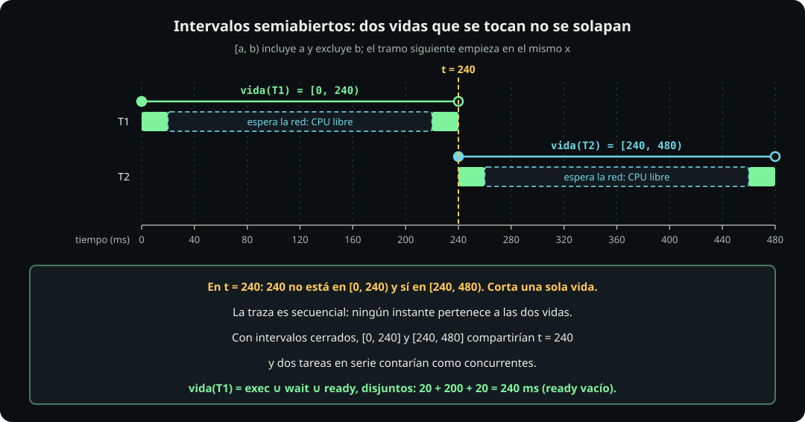

# Dónde pasa el tiempo

**Página 1 de 8 · Cómputo y concurrencia** · Pregunta: **¿por qué 20 peticiones tardan 20 veces lo que una, y qué parte de ese tiempo es tu programa trabajando?** · Meta: partir la vida de una tarea en ejecuta, espera y lista, medir la fracción que ejecuta y leer el resultado en un Gantt y en un presupuesto de latencia.

| Término | Definición de una línea | Símbolo |
|---|---|---|
| tarea | flujo secuencial de trabajo con inicio y fin, observado desde un sistema elegido | $\tau_i$ |
| intervalo semiabierto | incluye su inicio y excluye su fin | $[a,b)$ |
| vida | del inicio al fin de la tarea | $[\operatorname{start},\operatorname{end})$ |
| latencia | lo que percibe quien pidió, incluida la cola previa | $\operatorname{end}-\operatorname{arrival}$ |
| ejecuta / espera / lista | CPU corriendo la tarea / algo externo pendiente / podría avanzar pero no tiene turno | $e$, $w$, $r$ |
| $\rho$ | fracción de la vida que ejecuta, con la tarea sola | $e/d$ |
| CPU-bound / I/O-bound | cuello de botella en ejecutar / en esperar, medido con $\rho$ | $\rho\approx1$ / $\rho$ pequeño |
| secuencial | cada tarea empieza cuando la anterior terminó | $T=\sum d_i$ |

## En corto

- **La vida de una tarea se parte en ejecuta, espera y lista**, y las tres suman la vida. Con la tarea sola, sólo hay ejecuta y espera.
- **$\rho$ es una medición, no una etiqueta**: una llamada a la API ejecuta una fracción mínima de su vida; un bucle de Python ejecuta casi toda.
- **En secuencia las vidas se suman**: 20 llamadas de 0.2 s son 4 s, y el servidor que las atiende una por una no pasa de unas 5 por segundo.

## Tarea, instantes y latencia

::: definition {#cmp-def-tarea title="Tarea"}
**En palabras.** Una tarea es un flujo secuencial de trabajo con inicio y fin, observado desde un sistema elegido (casi siempre el cliente); vive desde que ese sistema la admite hasta que termina, y su latencia suma además la cola previa.

**Formalmente.** Con $\mathcal{T}=\{\tau_1,\dots,\tau_n\}$ y $\operatorname{arrival}(\tau)\le\operatorname{start}(\tau)<\operatorname{end}(\tau)$: $\operatorname{vida}(\tau)=[\operatorname{start}(\tau),\operatorname{end}(\tau))$, $d(\tau)=\operatorname{end}-\operatorname{start}$, $\operatorname{latencia}(\tau)=\operatorname{end}-\operatorname{arrival}$. ([[notacion-computo]])

Ejemplos: una llamada a la API, un cálculo, una petición que atiende un servidor. Ocupa a lo más una CPU a la vez y siempre se compara sobre el mismo conjunto $\mathcal{T}$.
:::

Una tarea tiene tres instantes distintos:

| Instante | Qué marca | En una API |
|---|---|---|
| $\operatorname{arrival}(\tau)$ | llega la solicitud | el cliente envía la petición |
| $\operatorname{start}(\tau)$ | el sistema observado **admite** la tarea | un hilo del servidor toma la conexión |
| $\operatorname{end}(\tau)$ | termina | sale la última respuesta |

::: definition {#cmp-def-latencia title="Vida, duración y latencia"}
La **vida** de la tarea es $\operatorname{vida}(\tau)=[\operatorname{start}(\tau),\operatorname{end}(\tau))$ y su **duración** es $d(\tau)=\operatorname{end}-\operatorname{start}$. La **latencia** es lo que percibe quien pidió: $\operatorname{latencia}(\tau)=\operatorname{end}-\operatorname{arrival}$. Siempre $\operatorname{arrival}\le\operatorname{start}<\operatorname{end}$; la diferencia $\operatorname{start}-\operatorname{arrival}$ es el tiempo en **cola** antes de que la admitan.
:::

**Otro ángulo.** Latencia = tiempo en cola + duración de la vida:

| | Mide | Quién lo percibe |
|---|---|---|
| $d$ | desde que la admiten | quien mide dentro del sistema |
| latencia | desde que llegó | el usuario o el cliente |
| $\operatorname{start}-\operatorname{arrival}$ | la cola | nadie lo ve en el código de la tarea |

**Ejemplo (traza ilustrativa).** Tres tareas llegan en $t=0$ a un sistema que atiende una a la vez. Cada una dura 240 ms.

| Tarea | arrival | start | end | $d$ | cola | latencia |
|---|---:|---:|---:|---:|---:|---:|
| $\tau_1$ | 0 | 0 | 240 | 240 | 0 | 240 |
| $\tau_2$ | 0 | 240 | 480 | 240 | 240 | 480 |
| $\tau_3$ | 0 | 480 | 720 | 240 | 480 | 720 |

La latencia media es $(240+480+720)/3=480$ ms, el doble de lo que dura cualquiera: dos tercios de la latencia de $\tau_3$ son cola: $480/720=2/3$.

## Intervalos semiabiertos

::: definition {#cmp-def-intervalo title="Intervalo semiabierto"}
**En palabras.** Un instante es un punto del reloj; un intervalo $[a,b)$ incluye su inicio y excluye su fin, así que dos intervalos que se tocan en un borde no se solapan.

**Formalmente.** $\operatorname{dur}(X)$ suma las longitudes de los intervalos disjuntos que forman $X$: $[a,b)=\{t\ge0 : a\le t<b\}$. ([[notacion-computo]])
:::

::: figure {#cmp-intervalos title="Intervalo semiabierto: dos vidas que se tocan en 240 no se solapan"}

:::

**Matemática.** $[0,240)\cap[240,480)=\varnothing$: el instante 240 es de la segunda tarea, no de la primera. Por eso la barra siguiente del Gantt empieza en el mismo punto donde acaba la anterior y aun así no hay traslape. Se escribe $\operatorname{dur}(X)$ para la longitud total de un conjunto de instantes: $\operatorname{dur}([0,20)\cup[220,240))=40$.

**Arquitectura.** La convención no es un detalle de dibujo: es lo que permite decir que un servidor secuencial **nunca** tiene dos peticiones en curso, aunque la segunda arranque en el mismo milisegundo en que acaba la primera.

## Los estados de una tarea

::: definition {#cmp-def-estados title="Ejecuta, espera y lista"}
En cada instante de su vida una tarea está en un solo estado:

- **ejecuta** ($\operatorname{exec}$): una CPU corre instrucciones de la tarea (parsear un JSON, un bucle).
- **espera** ($\operatorname{wait}$): la tarea espera algo **externo al programa**: la respuesta de la red, el disco, un temporizador.
- **lista** ($\operatorname{ready}$): la tarea **podría** avanzar, pero no tiene turno: no hay una CPU libre.

Los tres conjuntos son disjuntos y cubren la vida: es una partición.
:::

::: figure {#cmp-estados-tarea title="Estados de una tarea: nueva, lista, ejecutando, esperando, lista y terminada"}

:::

- **nueva** es antes de $\operatorname{start}$: la solicitud llegó y espera admisión; no forma parte de la vida.
- **esperando → lista**: llegar la respuesta habilita a la tarea; no interrumpe a la que ejecuta.
- Con una sola tarea y una CPU libre, el paso lista → ejecutando es inmediato y $r=0$.

**La prueba operativa** para clasificar un tramo:

1. «Si ahora mismo le doy una CPU libre, ¿avanza?» **Sí → `ready`.**
2. Si no avanza, ¿qué tiene que ocurrir? Algo fuera del programa (llega un paquete, vence un temporizador) → **`wait`**.

(Hay un cuarto estado, `blocked`: espera algo que otra tarea del mismo programa debe soltar o producir. Está en [[notacion-computo]] y se usa desde la página 2; aquí vale $b=0$.)

**Matemática.** Con $e$, $w$, $r$ las duraciones de cada conjunto:

$$d(\tau)=e+w+r\qquad(+\,b\text{ cuando haya bloqueo})$$

El modelo de la página 0, [[notacion-computo]], escribe la versión completa $d=e+w+r+b$.

**Ejemplo.** Una tarea del ejemplo único: ejecuta 20 ms, espera 200 ms la red, ejecuta 20 ms. Sola, en una CPU libre:

| Tramo | Estado | Intervalo |
|---|---|---|
| 1 | ejecuta | $[0,20)$ |
| 2 | espera | $[20,220)$ |
| 3 | ejecuta | $[220,240)$ |

$e=20+20=40$, $w=200$, $r=0$: $d=40+200+0=240$ ms.

**Arquitectura.** Cada estado se acelera con algo distinto:

| Estado dominante | Qué lo reduce | Qué no lo reduce |
|---|---|---|
| ejecuta | menos instrucciones, mejor algoritmo, más CPU | solapar esperas |
| espera | acortar la espera (caché, otra región, menos viajes) o **solaparla** con otra espera | más CPU, un algoritmo más rápido |
| lista | más CPU libres, o menos tareas compitiendo | acortar la red |

## $\rho$ y el cuello de botella

::: definition {#cmp-def-rho title="ρ, CPU-bound e I/O-bound"}
**En palabras.** $\rho$ es la fracción de la vida que la tarea ejecuta, medida con la tarea sola; cerca de 1 es CPU-bound, pequeña es I/O-bound.

**Formalmente.** $\rho(\tau)=e/d$ medido con $r=b=0$. ([[notacion-computo]])

Una tarea es **CPU-bound** si $\rho\approx1$: su cuello de botella es ejecutar. Es **I/O-bound** si $\rho$ es pequeño: su cuello de botella es esperar. Es una clasificación **empírica** del cuello de botella, no una propiedad eterna del código.
:::

**Otro ángulo.** Lo que cambia $\rho$ sin tocar el código:

| Cambio | Efecto en $\rho$ |
|---|---|
| el servidor responde en 20 ms en lugar de 200 | $w$ baja, $\rho$ sube |
| la respuesta pasa de 1 KB a 50 MB de JSON | $e$ sube (parsear), $\rho$ sube |
| otra frontera: observar el servidor en vez del cliente | lo que era espera pasa a ser ejecución |
| el mismo código en otra máquina | $e$ cambia, $\rho$ también |

No hay umbral universal: $\rho$ cerca de 0 o de 1 son los extremos claros; en medio hay que mirar con cuál de los dos tramos se gana más.

**Matemática.** Para la tarea del ejemplo: $\rho=40/240=1/6\approx16.7\,\%$. Cinco sextos de su vida espera. Si se llevara $e$ a cero, el tiempo bajaría de 240 a 200 ms (1.2 veces); si se llevara $w$ a cero, de 240 a 40 ms (6 veces). La fracción $\rho$ acota lo que se puede ganar acelerando la ejecución: nunca más de $1/(1-\rho)$ veces.

**Ejemplo.** Las mediciones de la celda 1.1 (una llamada con `?lento=0.2` contra un bucle de Python) dan $\rho$ casi 0 para la llamada y $\rho\approx1$ para el bucle: la misma máquina, el mismo Python, dos cuellos de botella opuestos.

**Arquitectura.** Mide antes de elegir. Un `for` que llama a un servicio y un `for` que suma enteros se ven igual en el código y piden cosas opuestas:

| $\rho$ medido | Pregunta que sigue | Páginas |
|---|---|---|
| pequeño | ¿se pueden solapar estas esperas? | 2, 3, 4, 5 |
| cerca de 1 | ¿se puede repartir el cálculo, o sacar el bucle del intérprete? | 6, 7 |
| en medio | ¿cuál tramo se puede reducir más barato? | 8 |

## Los dos relojes

Medir $\rho$ en Python exige dos relojes distintos:

| Reloj | Qué mide | Cuenta la espera |
|---|---|---|
| `time.perf_counter()` | segundos reales de pared | sí |
| `time.process_time()` | segundos de CPU que consumió **el proceso** | no |

Con ellos, sobre un lote: $T$ es la diferencia de `perf_counter` y $C\approx$ la diferencia de `process_time`. Una tarea sola I/O-bound da $C/T$ casi 0; una CPU-bound, casi 1.

> [!WARNING]
> Lo que mide `process_time` es el **proceso**, no una tarea: suma los hilos y no cuenta procesos hijos. Y $T-C$ es el **tiempo sin CPU del cliente**: en este experimento lo domina la espera de la red, pero también incluye turnos y otros efectos. No es $\sum w$. Con 20 llamadas en serie, el 99.4 % es tiempo sin CPU del cliente; no es «el 99.4 % es red».

**Matemática.** Con la medición de referencia de las 20 llamadas en serie: $T=4.04$ s y $C\approx0.02$ s. $(T-C)/T=99.4\,\%$ del reloj sin CPU del cliente. Si se eliminara por completo la CPU, el speedup máximo sería $1/0.994\approx1.006$ (cifras de referencia, una corrida; los segundos publicados se redondean por separado): lo que hay que reorganizar son las esperas.

## Secuencial y el Gantt

::: definition {#cmp-def-secuencial title="Secuencial"}
**En palabras.** Ningún par de vidas se solapa: cada tarea empieza cuando la anterior terminó.

**Formalmente.** $\forall i\ne j:\ \operatorname{vida}(\tau_i)\cap\operatorname{vida}(\tau_j)=\varnothing$. ([[notacion-computo]])
:::

::: figure {#cmp-gantt-secuencial title="Tres tareas en secuencia: las esperas se suman y la CPU queda ociosa"}

:::

Convención de los Gantt de la unidad: **ejecuta** relleno, **espera** con contorno, **lista** rayada. Hay una fila por tarea y una fila de CPU.

**Matemática.** En secuencia, y sólo en secuencia, el total es la suma de las vidas:

$$T=\sum_i d_i=3\times240=720\ \text{ms}$$

| Magnitud | Cuenta | Valor |
|---|---|---|
| CPU del lote | $C=\sum e_i=3\times40$ | 120 ms |
| CPU ociosa | $T-C=720-120$ | 600 ms |
| utilización | $U=C/(P\cdot T)=120/(1\times720)$ | 16.7 % |
| latencias | $240,\ 480,\ 720$ | media 480 ms |

La CPU está libre durante toda espera y el programa no pone otro trabajo en ese hueco.

**Ejemplo (medición real).** Las 20 llamadas de la celda 1.2: $T=4.04$ s, unos 0.202 s por llamada, y 99.4 % del reloj sin CPU del cliente. Cada `requests.get` bloquea hasta recibir la respuesta, así que la siguiente no puede salir antes.

**Arquitectura.** Cuándo conviene la secuencia:

| Sí | No |
|---|---|
| la tarea $k+1$ necesita el resultado de la $k$ (dependencia de datos) | tareas independientes que esperan |
| el proveedor limita a una petición a la vez | cientos de llamadas a un servicio que aguanta más |
| depurar, o tener una línea base contra la que medir | un endpoint cuyo tiempo es casi todo espera |
| pocas tareas, cada una muy corta | cada espera suma a la latencia del usuario |

La secuencia es la **línea base**: toda mejora de la unidad se mide contra ella, declarando que la base es la versión secuencial.

## Un servidor secuencial como línea base

Un servidor secuencial atiende una conexión, termina, y recién entonces toma la siguiente. Las conexiones que llegan mientras tanto esperan en una cola **FIFO** (la primera en llegar es la primera en atenderse): en el servidor de la clase esa cola es el *backlog* de `listen()`, de 1024 lugares.

**Matemática.** A lo más una tarea dentro del sistema: $L\le k=1$. La **Ley de Little** relaciona tareas en vuelo $L$, rendimiento $\lambda$ (tareas terminadas por segundo) y tiempo medio en el sistema $W$:

$$L=\lambda\cdot W\quad\Rightarrow\quad\lambda\le\frac{k}{W}=\frac{1}{W}$$

| Caso | Cuenta | Resultado |
|---|---|---|
| $W=0.2$ s (la espera fabricada) | $1/0.2$ | $\lambda\le5$ peticiones/s |
| $W=0.202$ s (medido en la serie de referencia) | $1/0.202$ | $\lambda\le4.95$ peticiones/s |
| las 20 llamadas de referencia | $\lambda=20/4.04$ | $\approx4.95$/s, $L=4.95\times0.202=1.0$ |

Un servidor secuencial **no puede** pasar de $1/W$, por más CPU que tenga.

**Ejemplo (cifras supuestas, rotuladas).** Si llegan 10 peticiones por segundo a un servidor que sólo puede atender 5, la cola crece: tras 10 s han llegado 100, se atendieron 50 y quedan 50 formadas. La petición que llega entonces espera unos $50\times0.2=10$ s antes de que la admitan. La latencia **de cola** crece sin límite mientras la llegada supere a $1/W$, aunque la duración $d$ de cada petición siga siendo 0.2 s.

**Arquitectura.** El servidor secuencial sirve de línea base y de caso de estudio:

| | Servidor secuencial | Lo que sigue |
|---|---|---|
| Qué | una conexión a la vez; el resto en la cola FIFO | hilo por conexión, event loop, procesos (págs. 2, 3, 8) |
| Cuándo sí | poca carga, desarrollo, lógica que no soporta concurrencia | |
| Cuándo no | espera larga por petición, picos de llegada | |
| Qué cuesta | $\lambda\le1/W$ y latencia de cola que crece con la carga | |
| Sistema real | `http.server.HTTPServer` (un hilo); un *worker* `sync` de Gunicorn atiende una petición a la vez | |

Cuando la cola crece sin tope, el síntoma es la latencia que percibe el usuario, no la duración dentro del servidor.

## Presupuesto de latencia de un endpoint

Un endpoint (cifras supuestas, rotuladas) hace tres cosas en secuencia: una consulta a la base de datos de 50 ms, una llamada a una API externa de 1.5 s y 1 ms de CPU propia para armar la respuesta.

| Etapa | Tiempo | Estado dominante | Fracción |
|---|---:|---|---:|
| BD | 50 ms | espera | 3.2 % |
| API externa | 1500 ms | espera | 96.7 % |
| CPU propia | 1 ms | ejecuta | 0.06 % |
| **Total** | **1551 ms** | | $\rho=1/1551\approx0.06\,\%$ |

**Qué optimizar.**

| Opción | Ahorro | Veredicto |
|---|---:|---|
| reescribir el código propio al doble de velocidad | 0.5 ms | no vale la pena |
| llevar la CPU propia a cero | 1 ms (0.06 %) | tampoco |
| solapar la BD con la API, si no dependen una de otra | 50 ms (el total pasa a $\max(50,1500)+1=1501$ ms) | sirve poco: la API sigue mandando |
| acortar o evitar la llamada a la API (caché, otra fuente) | hasta 1500 ms | el único cambio que importa |

El presupuesto pone el esfuerzo donde está el tiempo. Un perfilador de CPU sobre este endpoint apuntaría a 1 ms; el reloj de pared apunta a la API.

## La decisión hasta aquí

| Pregunta | Respuesta de esta página | Evidencia |
|---|---|---|
| ¿Dónde está el tiempo de mi tarea? | medir $\rho$ con la tarea sola | `perf_counter` contra `process_time` (celda 1.1) |
| ¿Cuánto puedo ganar acelerando el cálculo? | a lo más $1/(1-\rho)$ veces | $\rho\approx0.06\,\%$ en el endpoint, 16.7 % en el ejemplo |
| ¿Qué pasa si no hago nada? | las esperas se suman: $T=\sum d_i$ | 20 llamadas, 4.04 s (celda 1.2) |
| ¿Cuántas peticiones por segundo da un servidor secuencial? | $\lambda\le1/W$ | $W=0.2$ s da 5/s |
| ¿Qué mido antes de elegir una herramienta? | el presupuesto: tiempo por etapa y quién domina | el endpoint de 1551 ms |

## Código

La unidad corre contra el servidor de la clase; las instrucciones para arrancarlo están en [[computo-y-concurrencia]] (sección «Antes de la clase»). Las dos celdas son del notebook `computo.ipynb`.

**Haz (celda 1.1):** mide con los dos relojes una llamada con `?lento=0.2` y un bucle puro de Python.

```python
# celda 1.1
import time, requests
from cable import URL

def cuenta(n=3_000_000):
    suma = 0
    for i in range(n): suma += i * i      # bucle puro: nunca espera
def mide(nombre, tarea):
    r0, c0 = time.perf_counter(), time.process_time()   # pared y CPU
    tarea()
    r, c = time.perf_counter() - r0, time.process_time() - c0
    print(f"{nombre:22} reloj {r:5.2f} s   CPU {c:5.2f} s   CPU/reloj {c / r:5.0%}")
mide("llamada ?lento=0.2", lambda: requests.get(f"{URL}/ventas?lento=0.2", timeout=5))
mide("bucle puro de Python", cuenta)
```

**Python que quizá no has visto**

| Construcción | Qué es | Por qué hace falta aquí |
|---|---|---|
| `lambda: …` | función anónima sin argumentos | `mide` recibe la tarea sin ejecutarla, para poner los relojes antes y después |
| `{c / r:5.0%}` | formato de f-string: la fracción como porcentaje en 5 columnas | muestra $\rho$ directamente |
| `timeout=5` | segundos máximos que `requests.get` espera la respuesta | una espera sin tope puede colgar la celda |

**Qué pasó:**

| Tarea | Reloj | CPU | Estado dominante |
|---|---|---|---|
| llamada `?lento=0.2` | mucho mayor | casi nada | espera |
| bucle puro | igual a la CPU | igual al reloj | ejecuta |

**Deberías ver:**

```text
llamada ?lento=0.2     reloj  0.20 s   CPU  0.00 s   CPU/reloj    1%
bucle puro de Python   reloj  0.18 s   CPU  0.18 s   CPU/reloj   99%
```

**Haz (celda 1.2):** llama 20 veces seguidas y reparte el tiempo entre CPU y tiempo sin CPU.

```python
# celda 1.2
import time, requests
from cable import URL

N = 20
r0, c0 = time.perf_counter(), time.process_time()
for _ in range(N):                          # una llamada tras otra: secuencial
    requests.get(f"{URL}/ventas?lento=0.2", timeout=5)
r, c = time.perf_counter() - r0, time.process_time() - c0
print(f"{N} llamadas en serie: {r:.2f} s  ({r / N:.3f} s por llamada)")
print(f"ejecuta (CPU):  {c:.2f} s  ({c / r:.1%})")
print(f"espera:         {r - c:.2f} s  ({(r - c) / r:.1%})")
print(f"sueño pedido al servidor: {N * 0.2:.1f} s")
```

**Python que quizá no has visto**

| Construcción | Qué es | Por qué hace falta aquí |
|---|---|---|
| `for _ in range(N)` | repetir N veces sin usar el índice | las 20 llamadas son idénticas |
| `r, c = a, b` | asignación de dos valores en una línea | calcula reloj y CPU del lote a la vez |

**Qué pasó:** cada `requests.get` bloqueó hasta recibir la respuesta, así que la siguiente salió después.

```text
t =    0 ms   llamada 1  ──── 0.2 s ────┐
t ≈  202 ms   llamada 2  ──── 0.2 s ────┤   ...
t ≈ 3.8 s     llamada 20 ──── 0.2 s ────┘   total ≈ 20 × 0.202 s
```

**Deberías ver:**

```text
20 llamadas en serie: 4.04 s  (0.202 s por llamada)
ejecuta (CPU):  0.02 s  (0.6%)
espera:         4.01 s  (99.4%)
sueño pedido al servidor: 4.0 s
```

La línea «espera» es el tiempo **sin CPU del cliente** ($T-C$), no la suma de las esperas del servidor; coincide con ella sólo porque aquí la red domina. El total fue de 4.04 s; con 100 o 500 llamadas la serie no se mide en clase (serían 20 s y 100 s), se calcula: $N\times0.2$ s.

La versión larga y paso a paso está en el notebook, tema 1.

## Al diseñar / al revisar código de IA, busca…

- **Un `for` que llama a una API, a una base de datos o a un archivo en cada vuelta**: si las llamadas no dependen una de otra, las esperas se están sumando sin necesidad.
- **Optimización de la parte equivocada**: reescrituras de algoritmo o más CPU sobre un programa cuyo $\rho$ es pequeño. Pide la medición de reloj contra CPU antes de aceptar el cambio.
- **«Esto es rápido» o «esto es lento» sin medir**, o con un solo número en lugar de la proporción ejecuta/espera.
- **Un 99 % de «espera» leído como suma de esperas** o como «el servidor es lento»: es tiempo sin CPU del cliente.
- **Una llamada de red sin `timeout`**: la espera no tiene tope (ver [[metodos-y-status]]).
- **Un servidor atendiendo una petición a la vez con picos de llegada**: la latencia de cola crece aunque cada petición dure poco.
- **Un presupuesto de latencia que no suma**: las etapas medidas deben dar el total observado.

Sigue con [[secuencial-concurrente-paralelo]].
