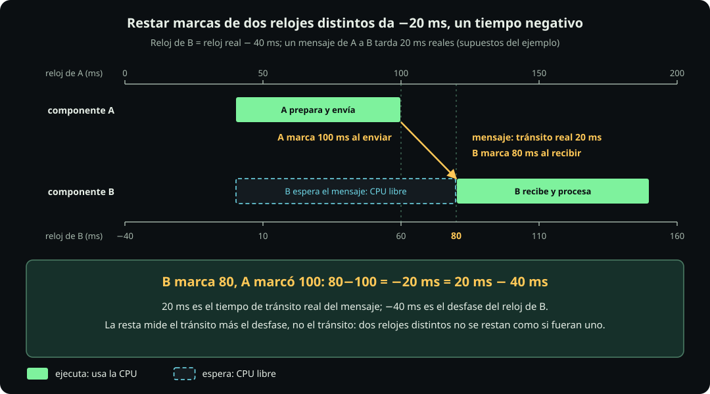
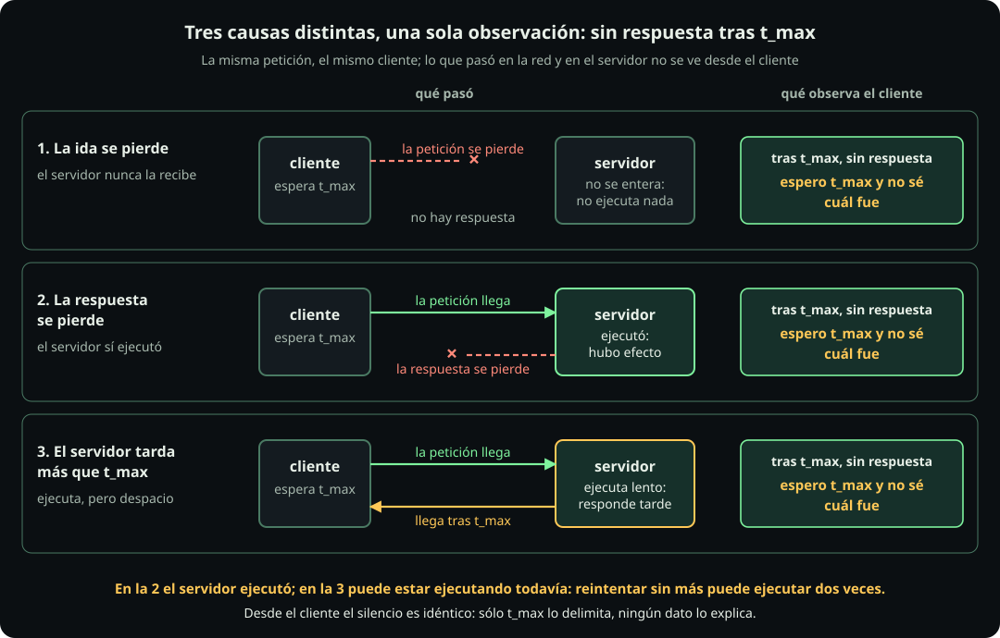

# Sistemas distribuidos

**Página 9 · Cómputo y concurrencia** · Pregunta: **¿por qué una petición sin respuesta no dice si falló?** · Respuesta: **la red no acota el retardo ni garantiza la entrega, así que un plazo vencido solo indica que el cliente dejó de esperar.**

## A. Relojes y causalidad

| Término | Definición |
|---|---|
| **Componente** | Un **componente** es un proceso o una máquina independiente. |
| **Mensaje** | Un **mensaje** consiste en datos enviados entre componentes. |
| **Reloj local** | Un **reloj local** es el reloj propio de cada componente; dos componentes no lo comparten. |

::: definition {#cmp-def-precede title="La relación «precede» entre eventos"}
**Definición.** **X precede a Y** cuando el modelo puede afirmar que X ocurrió antes que Y por una cadena de causas, sin mirar ningún reloj. Es un orden parcial: no todo par de eventos queda ordenado.

**Variables.**

- $X$, $Y$: dos eventos cualesquiera (enviar, recibir o calcular algo en un componente).
- $m$: un mensaje; su envío y su recepción son dos eventos distintos.

**Reglas.** $X$ precede a $Y$ si se cumple al menos una:

1. **Orden local.** $X$ e $Y$ ocurren en el mismo componente y $X$ ocurre antes que $Y$ en él.
2. **Envío y recepción.** $X$ es el envío de un mensaje $m$ e $Y$ es la recepción de ese mismo $m$.
3. **Transitividad.** Existe un evento $Z$ tal que $X$ precede a $Z$ y $Z$ precede a $Y$.

**Por qué es así.** La regla 1 es fiable porque un solo componente ve sus eventos en una sola secuencia. La regla 2 es fiable porque un mensaje no puede recibirse antes de enviarse. La regla 3 encadena las dos primeras. Ninguna regla usa marcas de tiempo.

**Concurrentes.** Dos eventos son **concurrentes** si ninguno precede al otro según las tres reglas: el modelo no les asigna orden.
:::

**Ejemplo paso a paso.** Tres eventos y dos mensajes.

1. **Datos.** Componentes A, B y C. Evento $a$: A envía $m_1$ a C. Evento $b$: B envía $m_2$ a C. Evento $c$: C recibe $m_1$ y $m_2$.
2. **Regla 2 sobre $m_1$.** $a$ es el envío de $m_1$ y $c$ su recepción → $a$ precede a $c$.
3. **Regla 2 sobre $m_2$.** $b$ es el envío de $m_2$ y $c$ su recepción → $b$ precede a $c$.
4. **Par $a$ y $b$.** Están en componentes distintos, ningún mensaje va de uno al otro y no hay cadena → ni $a$ precede a $b$ ni $b$ a $a$.
5. **Lectura.** $a$ y $b$ son concurrentes: uno ocurrió antes en tiempo real, pero el modelo no puede decir cuál.

::: figure {#cmp-dist-relojes title="Con relojes desfasados, restar marcas no da el tiempo de tránsito"}

Cómo leerla: ambos ejes representan el mismo instante real con números distintos; la flecha causal va de A a B.
:::

::: definition {#cmp-def-resta-marcas title="Resta de marcas entre relojes distintos"}
**Qué dice.** Restar la marca de llegada, tomada en el reloj de B, menos la marca de envío, tomada en el reloj de A, no da el tiempo que tardó el mensaje: da ese tiempo más la diferencia entre los dos relojes.

**Variables.**

- $\text{marca}_A$: lectura del reloj local de A al enviar, en ms.
- $\text{marca}_B$: lectura del reloj local de B al recibir, en ms.
- $\text{tránsito}$: tiempo real que tarda el mensaje en llegar, en ms (el que se quería medir).
- $\text{desfase}$: reloj de B menos reloj real, en ms, suponiendo que el reloj de A marca la hora real; negativo si el reloj de B va atrasado.

**Fórmula.**

$$\text{marca}_B-\text{marca}_A=\text{tránsito}+\text{desfase}$$

**Por qué es así.** Cada marca es el instante real más el desfase de su reloj: $\text{marca}_A=t_{\text{envío}}$ (el reloj de A no tiene desfase) y $\text{marca}_B=t_{\text{envío}}+\text{tránsito}+\text{desfase}$. Al restar, $t_{\text{envío}}$ se cancela y quedan el tránsito y el desfase.
:::

**Ejemplo paso a paso.**

1. **Datos (supuestos).** El reloj de B va 40 ms atrás, así que $\text{desfase}=-40$ ms. El tránsito real es 20 ms.
2. **Marca de envío.** A envía cuando su reloj marca $\text{marca}_A=100$ ms.
3. **Marca de llegada.** El mensaje llega 20 ms después en tiempo real; el reloj de B marca $100+20-40=80$ ms.
4. **Resta.** $\text{marca}_B-\text{marca}_A=80-100=-20$ ms.
5. **Comprobación.** $\text{tránsito}+\text{desfase}=20+(-40)=-20$ ms, igual a la resta.
6. **Lectura.** Según las marcas, el mensaje llegó antes de enviarse. Con relojes distintos, la resta no mide el tránsito mientras no se conozca el desfase y su incertidumbre.

**Ejemplo.** El registro de A dice «envié a las 100 ms» y el de B dice «recibí a las 80 ms». Ordenarlos por marca coloca la recepción antes del envío, aunque el envío precede a la recepción por definición.

**Arquitectura.**
- **Qué es:** reconstruir el orden entre máquinas mediante mensajes, no mediante relojes. Cada evento se ordena por lo que recibió o envió antes.
- **Cuándo sí:** cuando el orden determina el resultado, como identificar la última escritura o qué evento causó otro.
- **Cuándo no:** para medir duraciones dentro de un componente, porque basta un solo reloj local monotónico.
- **Qué cuesta:** cada mensaje lleva información de orden, que el sistema debe mantener. Dos eventos concurrentes no tienen orden causal: uno ocurrió antes en tiempo real, pero el sistema no puede determinarlo.
- **Sistema real:** el identificador de petición que un servicio pasa a los siguientes permite ordenar eventos por causa, no por marca, en trazas distribuidas.

**Decisión que permite:** no comparar marcas de máquinas distintas para ordenar eventos ni para medir tiempos de tránsito.

## B. Resultado desconocido

| Término | Definición |
|---|---|
| **Plazo** | El **plazo** $t_{\max}$ es el tiempo máximo que espera el cliente. |
| **Fallo parcial** | Un **fallo parcial** ocurre cuando falla un componente o un mensaje, pero el resto continúa. |
| **Operación idempotente** | Una **operación idempotente** produce el mismo efecto al repetirse que al ejecutarse una vez. |

**Definición.** Un **resultado desconocido** es el estado del cliente que, al vencer $t_{\max}$ sin respuesta, ignora si la operación se ejecutó.

Ocurre por un fallo parcial y porque la red no acota el retardo ni garantiza la entrega; un reloj común no lo resolvería, porque $t_{\max}$ se mide con el reloj local del cliente.

::: figure {#cmp-dist-tres-causas title="Tres fallos distintos se ven igual para el cliente"}

Cómo leerla: el cliente observa lo mismo en los tres carriles; solo cambia lo ocurrido del otro lado.
:::

::: definition {#cmp-def-plazo title="Plazo vencido y sus tres causas"}
**Qué dice.** El **plazo** $t_{\max}$ es el tiempo que el cliente decide esperar. Cuando vence sin respuesta, el cliente sabe que dejó de esperar y nada más: no sabe qué ocurrió del otro lado.

**Variables.**

- $t_{\max}$: plazo del cliente, en ms, medido con el reloj local del cliente.

**Condición.** Hay plazo vencido cuando el cliente espera $t_{\max}$ sin recibir respuesta.

**Causas posibles.** Las tres producen la misma observación en el cliente:

1. **Se perdió la ida.** La petición no llegó; la operación no se ejecutó.
2. **Se perdió la vuelta.** El servidor ejecutó la operación (o cayó justo después de ejecutarla) y la respuesta no llegó.
3. **Servidor lento.** El servidor sigue trabajando y tardará más que $t_{\max}$ en responder.

**Por qué es así.** La red no acota el retardo ni garantiza la entrega, así que ninguna observación del cliente descarta una de las tres causas. Solo en la causa 1 la operación no ocurrió.
:::

**Ejemplo paso a paso.**

1. **Datos.** El cliente pide «cobrar 100 pesos» y espera $t_{\max}=2000$ ms sin recibir respuesta.
2. **Causa 1.** La petición se perdió → cobro: 0 pesos.
3. **Causa 2.** El servidor cobró y la respuesta se perdió → cobro: 100 pesos.
4. **Causa 3.** El servidor sigue procesando → cobro: 100 pesos al terminar.
5. **Lectura.** El cliente observa lo mismo en los tres casos y el resultado real va de 0 a 100 pesos. Reintentar sin más puede cobrar 200.

**Arquitectura.**
- **Qué es:** interpretar el plazo vencido como «dejé de esperar», no como «falló». El servidor puede seguir trabajando porque el plazo no cancela la operación.
- **Cuándo sí:** en toda llamada por red. El plazo evita esperas ilimitadas (ver timeouts en [[arquitectura-y-estrategia]]) y libera recursos del cliente, como los permisos de [[concurrencia-acotada]].
- **Cuándo no:** para concluir que la operación no ocurrió o repetir sin precaución una operación con efectos.
- **Qué cuesta:** reintentar sin más puede ejecutar la operación dos veces. La idempotencia lo evita, pero exige reconocer la repetición, por ejemplo mediante una clave reutilizada al reintentar.
- **Sistema real:** las APIs de pagos aceptan una clave de idempotencia para que un reintento tras un plazo vencido no cobre dos veces.

**Decisión que permite:** poner un plazo en cada llamada, reintentar solo operaciones idempotentes y consultar el estado cuando el resultado es desconocido.

## Si hay tiempo

- Los relojes lógicos (Lamport, 1978) asignan a cada evento un contador que respeta «precede»: si A precede a B, el contador de A es menor; la inversa no vale.

## Katas

::: problem {#cmp-kata-p9-1 title="Kata 1 · ¿Puedo reintentar el cobro?"}
Un cliente envía «cobrar 100 pesos» a un servicio de pagos con $t_{\max}=2000$ ms y no recibe respuesta. La operación no lleva clave de idempotencia. ¿Reintentas de inmediato? ¿Qué podrías hacer en su lugar?
:::

::: answer {of="cmp-kata-p9-1"}
**Elige:** no reintentar; consultar primero el estado del cobro. **Porque:** el plazo vencido no distingue las tres causas (caja «Plazo vencido y sus tres causas»); en las causas 2 y 3 ya se cobró y un reintento cobraría 200 pesos. **Descarta:** reintentar sin más (puede duplicar el efecto); concluir «no se cobró» (solo es cierto en la causa 1). Si el servicio acepta una clave de idempotencia, reintentar con la misma clave sí es seguro.
:::

::: problem {#cmp-kata-p9-2 title="Kata 2 · ¿Qué plazo pongo?"}
Una consulta de saldo tarda normalmente 30 ms y en el 99 % de los casos menos de 120 ms. Un cliente la llama sin plazo y un día el servidor deja de responder. ¿Cuánto tarda el cliente en enterarse y qué plazo pondrías?
:::

::: answer {of="cmp-kata-p9-2"}
**Elige:** un plazo finito, por ejemplo $t_{\max}=300$ ms (varias veces el caso típico; el valor exacto es una decisión, no una fórmula). **Porque:** sin plazo el cliente espera indefinidamente y retiene sus recursos, como los permisos de [[concurrencia-acotada]]. **Descarta:** $t_{\max}=30$ ms (vencería en muchas llamadas sanas) y no poner plazo. Al vencer, el cliente solo sabe que dejó de esperar; como la consulta no tiene efectos, reintentarla es seguro.
:::

::: problem {#cmp-kata-p9-3 title="Kata 3 · ¿Cuál ocurrió antes?"}
Una tienda tiene dos servidores. El log del servidor 1 dice «pago recibido 14:03:07» y el del servidor 2 dice «pedido creado 14:03:05». Los relojes no están sincronizados y se desconoce el desfase. ¿Cuál ocurrió antes? ¿Qué necesitas para saberlo?
:::

::: answer {of="cmp-kata-p9-3"}
**Elige:** no concluir nada por las marcas. **Porque:** cada marca es el instante real más el desfase de su reloj; con desfase desconocido, 14:03:05 menor que 14:03:07 no implica que el pedido fuera primero (un desfase de 3 s lo invierte). **Necesitas:** una relación causal (regla 2 de «precede»): por ejemplo, que el pedido lleve un identificador que el servidor 1 registre al recibir el pago; con eso, el pedido precede al pago sin usar relojes. **Descarta:** ordenar por marca y tomar la resta de marcas por el tiempo de tránsito.
:::

## Notebook

- Celda 9.1: simula dos relojes, el de B 40 ms atrás, y muestra la resta de marcas de un mensaje enviado en 100 ms con tiempo de tránsito de 20 ms. Salida esperada: -20 ms.
