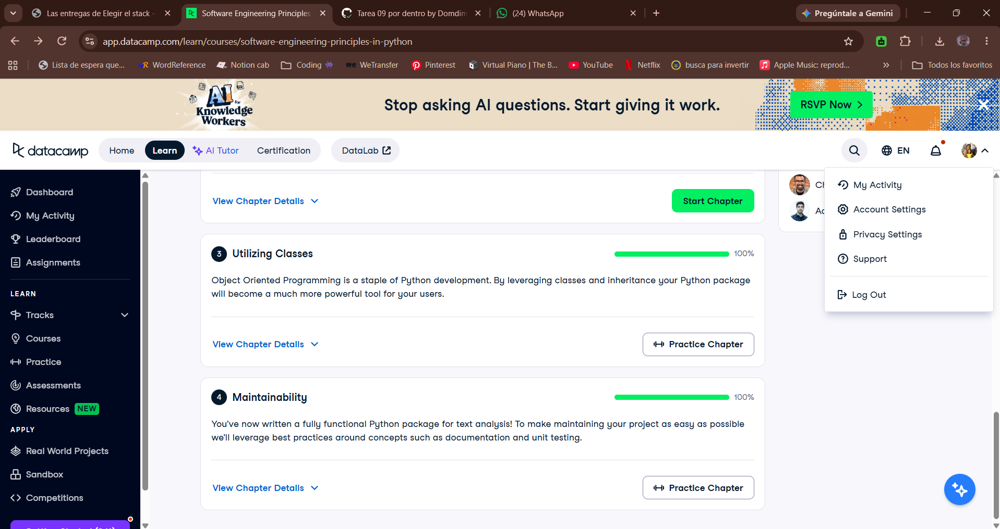

# Certificado: Software Engineering Principles in Python

Llena este archivo en **tu copia**, dentro de `estudiantes/<tu-login>/09_python/stack/`.

## Quién soy

- Usuario de GitHub: Domdimad0m
- Usuario de DataCamp: Dominique 

El repositorio es público: no escribas aquí tu nombre completo ni tu correo.

## Software Engineering Principles in Python, capítulos 3 y 4

Fecha en que terminaste el capítulo 4 (AAAA-MM-DD): 2026-10-27

## Una cosa que aprendiste y no sabías

Transferí los conocimientos que adquirí en EDA aplicado a Python. Reforcé conceptos sobre las clases y su funcionamiento, además de aprender a utilizar distintos paquetes. Algo interesante que no había notado es que los guiones bajos en los nombres de los métodos se utilizan para indicar su nivel de acceso por la convención en Python.
