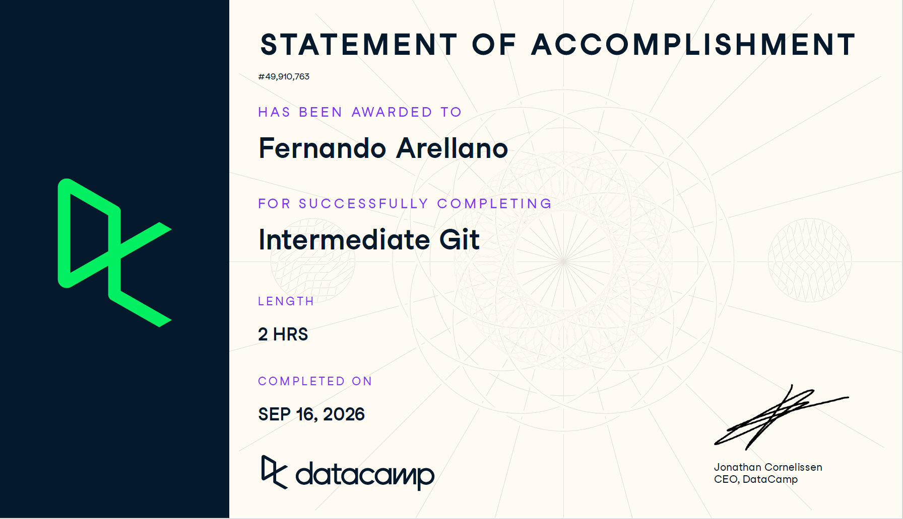

# Certificado: Intermediate Python for Developers

Llena este archivo en **tu copia**, dentro de `estudiantes/<tu-login>/09_python/por_dentro/`.

## Quién soy

- Usuario de GitHub:FerArGo56
- Usuario de DataCamp:Fernando

El repositorio es público: no escribas aquí tu nombre completo ni tu correo.

## Intermediate Python for Developers

Fecha en que lo terminaste (2026-10-07):

URL del Statement of Accomplishment:https://www.datacamp.com/completed/statement-of-accomplishment/course/ab1ca726f273efc791be67a38346f9dfb07524ac?utm_medium=organic_social&utm_campaign=sharewidget&utm_content=soa

## Una cosa que aprendiste y no sabías
Aprendi sobre como leer las lineas de error de python, sobre el paquete
strings y el uso de __doc__, recorde sobre el uso de lambda y algunas cosas de
las funciones.

Dos o tres líneas: algo concreto del curso que no sabías, o que tenías a medias
y ahí se te acomodó.
