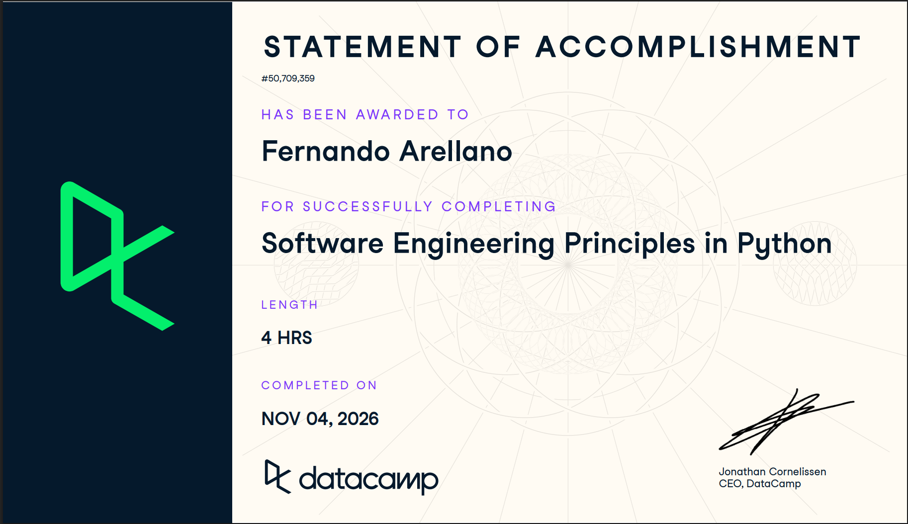

# Certificado: Software Engineering Principles in Python

Llena este archivo en **tu copia**, dentro de `estudiantes/<tu-login>/09_python/stack/`.

## Quién soy

- Usuario de GitHub:FerArGo56
- Usuario de DataCamp:Fernando

El repositorio es público: no escribas aquí tu nombre completo ni tu correo.

## Software Engineering Principles in Python, capítulos 3 y 4

Fecha en que terminaste el capítulo 4: 2026-11-03

## Una cosa que aprendiste y no sabías
Las clases en python no las habia visto antes asi que me ayudo a afianzar
eso, también me ayudo a veer los pytest y doctest.
Por cierto hice también el capitulo 1 y
2 por eso la foto es el certificado completo.
