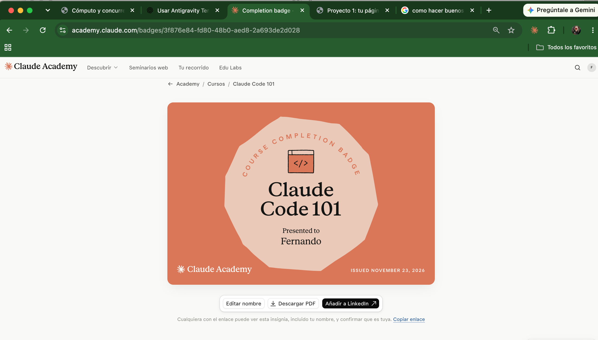

# Certificaciones de Claude Code

Llena este archivo en **tu copia**, dentro de `estudiantes/<tu-login>/claude_code/`.

## Quién soy

- Usuario de GitHub:FerArGo56

El repositorio es público: no escribas aquí tu nombre completo ni tu correo.

## Claude Code 101

Fecha en que lo terminaste (2026-11-23):

URL del badge de Claude Academy: https://academy.claude.com/verify/c130881b9a0d4d01bf5b36a3360f9210

Si no terminaste el curso, dilo aquí abajo: qué lecciones o qué parte del
quiz te faltaron. Reportar el pendiente cuenta como entrega.

## Una cosa que aprendiste y no sabías

No sabia nada sobre los MPC, aprendi mas de como usar los skills y tambien me ayudo mucho a entender como manejar el contexto dentro dee Claude Code

Se llena en esta entrega. Dos o tres líneas: algo concreto del curso que no
sabías, o que tenías a medias y ahí se te acomodó.
