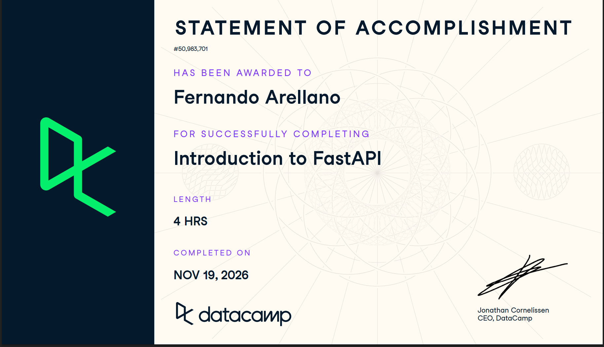

# Certificaciones de FastAPI

Llena este archivo en **tu copia**, dentro de `estudiantes/<tu-login>/fastapi/`.

## Quién soy

- Usuario de GitHub:FerArGo56
- Usuario de DataCamp:Fernando

El repositorio es público: no escribas aquí tu nombre completo ni tu correo.

## Introduction to FastAPI

Fecha en que lo terminaste (2026-11-18):

URL del Statement of Accomplishment:https://www.datacamp.com/completed/statement-of-accomplishment/course/4446e77532d93075f61f10a1094e865f0fa813ff?utm_medium=organic_social&utm_campaign=sharewidget&utm_content=soa

## Una cosa que aprendiste y no sabías
Aprendí que FastAPI permite crear APIs de manera sencilla utilizando 
decoradores para definir rutas y endpoints. No sabía que podía validar
automáticamente los datos que recibe una petición mediante modelos, 
detectando errores antes de procesar la información.

Se llena en esta entrega. Dos o tres líneas: algo concreto del curso que no
sabías, o que tenías a medias y ahí se te acomodó.

