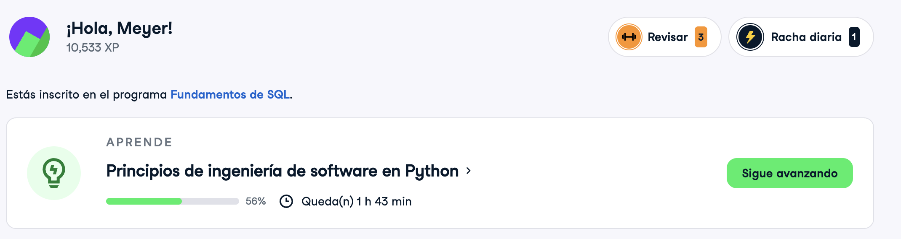

# Certificado: Software Engineering Principles in Python

Llena este archivo en **tu copia**, dentro de `estudiantes/<tu-login>/09_python/stack/`.

## Quién soy

- Usuario de GitHub: Meyer03
- Usuario de DataCamp: Meyer03

El repositorio es público: no escribas aquí tu nombre completo ni tu correo.

## Software Engineering Principles in Python, capítulos 3 y 4

Fecha en que terminaste el capítulo 4 (AAAA-MM-DD): 2026-10-27

## Una cosa que aprendiste y no sabías

Aprendí a refactorizar para simplificar funciones: partir una función larga en
funciones chicas que hacen una sola cosa y tienen nombres que dicen qué hacen.
Así cada pieza se lee, se prueba y se cambia por separado, sin cambiar lo que
hace el programa.
