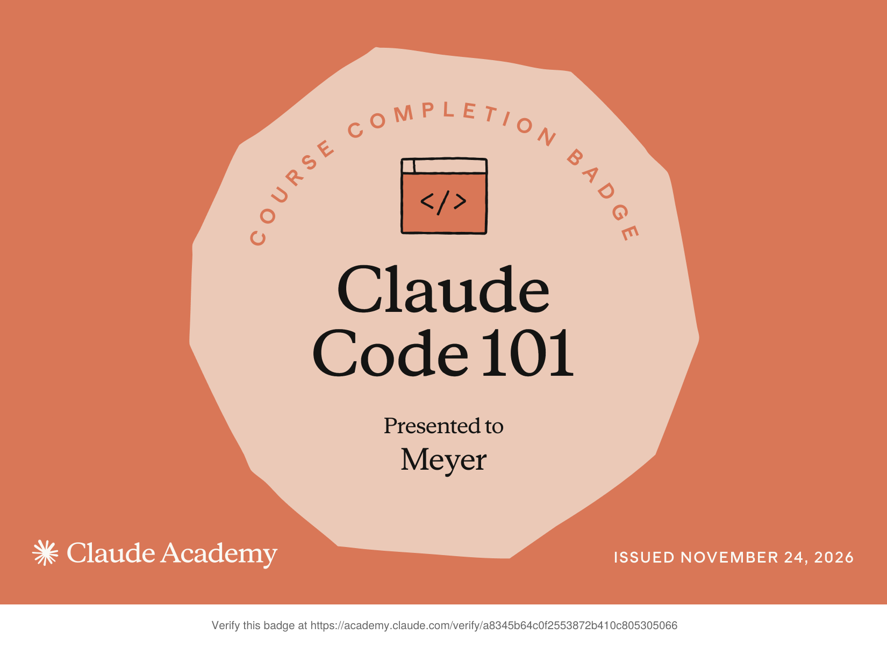

# Certificaciones de Claude Code

Llena este archivo en **tu copia**, dentro de `estudiantes/<tu-login>/claude_code/`.

## Quién soy

- Usuario de GitHub: Meyer03

El repositorio es público: no escribas aquí tu nombre completo ni tu correo.

## Claude Code 101

Fecha en que lo terminaste (AAAA-MM-DD): 2026-11-24

URL del badge de Claude Academy: https://academy.claude.com/verify/a8345b64c0f2553872b410c805305066

Si no terminaste el curso, dilo aquí abajo: qué lecciones o qué parte del
quiz te faltaron. Reportar el pendiente cuenta como entrega.

## Una cosa que aprendiste y no sabías

Se llena en esta entrega. Dos o tres líneas: algo concreto del curso que no
sabías, o que tenías a medias y ahí se te acomodó.

No tenía clara la diferencia entre un hook y una skill. Un hook es un comando que
se ejecuta siempre que ocurre cierto evento (por ejemplo, antes o después de usar
una herramienta), así que es determinista; una skill son instrucciones que el agente
carga sólo cuando la tarea las necesita, y él decide cuándo usarlas.
