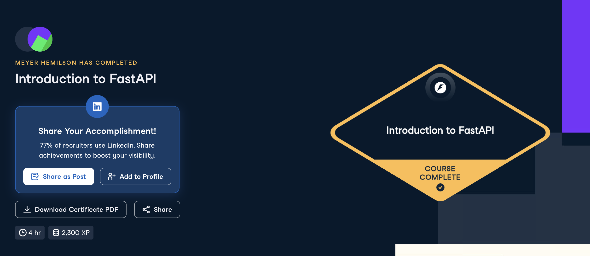

# Certificaciones de FastAPI

Llena este archivo en **tu copia**, dentro de `estudiantes/<tu-login>/fastapi/`.

## Quién soy

- Usuario de GitHub: Meyer03
- Usuario de DataCamp: Meyer03

El repositorio es público: no escribas aquí tu nombre completo ni tu correo.

## Introduction to FastAPI

Fecha en que lo terminaste (AAAA-MM-DD): 2026-11-03

URL del Statement of Accomplishment: https://www.datacamp.com/completed/statement-of-accomplishment/course/810a7142c9b81c68658d3846a3dbcc91f2ecf5e4?utm_medium=organic_social&utm_campaign=sharewidget&utm_content=soa

## Una cosa que aprendiste y no sabías

Repasé los diferentes tipos de errores que hay. También repasé la diferencia
entre PUT y POST, que siempre se me confunde.
