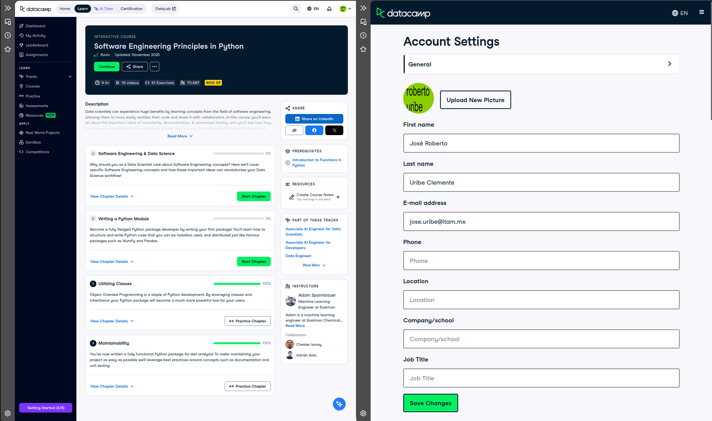

# Certificado: Software Engineering Principles in Python

Llena este archivo en **tu copia**, dentro de `estudiantes/<tu-login>/09_python/stack/`.

## Quién soy

- Usuario de GitHub: José Roberto
- Usuario de DataCamp: RobertoUribeClemente

El repositorio es público: no escribas aquí tu nombre completo ni tu correo.

## Software Engineering Principles in Python, capítulos 3 y 4

Fecha en que terminaste el capítulo 4 (AAAA-MM-DD):
2026-10-16

## Una cosa que aprendiste y no sabías

Dos o tres líneas: algo concreto de los capítulos 3 o 4 que no sabías, o que
tenías a medias y ahí se te acomodó.

Algo que no sabía bien era acerca de la importancia de la documentación de los archivos en Python mediante el
docstring, esto para mostrar en la terminal un ejemplo de cómo puede funcionar y, consigo mismo, el uso de Pytest
para testear cuál es la salida esperada de un ejemplo que da, esto para ver si imprime el valor esperado o no
