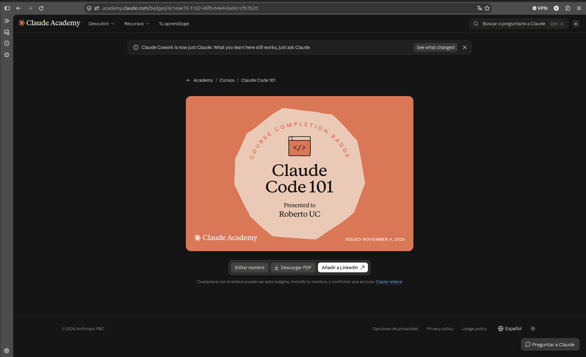

# Certificaciones de Claude Code

Llena este archivo en **tu copia**, dentro de `estudiantes/<tu-login>/claude_code/`.

## Quién soy

- Usuario de GitHub: RobertoUribeClemente

El repositorio es público: no escribas aquí tu nombre completo ni tu correo.

## Claude Code 101

Fecha en que lo terminaste (AAAA-MM-DD): 2026-11-04

URL del badge de Claude Academy: https://academy.claude.com/badges/4c1eae76-1162-48fb-b4e4-ba961cfb7b20

Si no terminaste el curso, dilo aquí abajo: qué lecciones o qué parte del
quiz te faltaron. Reportar el pendiente cuenta como entrega.

## Una cosa que aprendiste y no sabías

Se llena en esta entrega. Dos o tres líneas: algo concreto del curso que no
sabías, o que tenías a medias y ahí se te acomodó.

La diferencia entre CLAUDE.md y SKILL.md: Claude lee CLAUDE.md automáticamente al iniciar cada sesión del proyecto, aunque la tarea no tenga que ver, porque sirve para dar contexto general 
(cómo está organizado, qué comandos usar, convenciones). En cambio, de un SKILL.md al inicio solo ve la descripción, y carga el contenido completo cuando la tarea coincide con ella o cuando
 la invocas con /nombre
