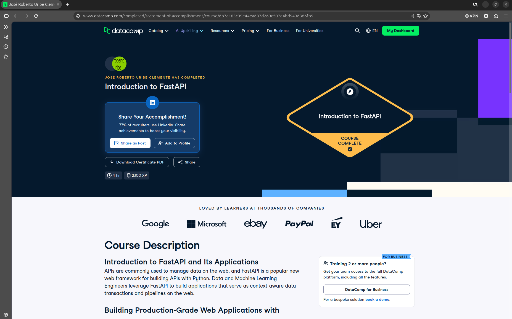

# Certificaciones de FastAPI

Llena este archivo en **tu copia**, dentro de `estudiantes/<tu-login>/fastapi/`.

## Quién soy

- Usuario de GitHub: RobertoUribeClemente
- Usuario de DataCamp: José Roberto

El repositorio es público: no escribas aquí tu nombre completo ni tu correo.

## Introduction to FastAPI

Fecha en que lo terminaste (AAAA-MM-DD): 2026-10-30

URL del Statement of Accomplishment: https://www.datacamp.com/completed/statement-of-accomplishment/course/6b7a183c99e44ea687d269c507e4bd94363d6fb9

## Una cosa que aprendiste y no sabías

Se llena en esta entrega. Dos o tres líneas: algo concreto del curso que no
sabías, o que tenías a medias y ahí se te acomodó.

Al momento de probar una API desde un script con 'request', manda no solamente cada operación del CRUD (que ya sabía previamente),
sino que también se podía verificar con un 'assert' tanto el código de estado como el JSON de respuesta.
No solamente revisa que regrese bien la respuesta, sino también los errores esperados (como el 404 al consultar algo que se borró).
