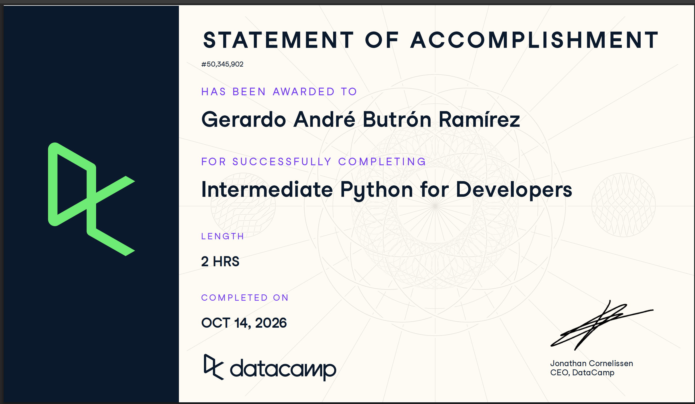

# Certificado: Intermediate Python for Developers

Llena este archivo en **tu copia**, dentro de `estudiantes/<tu-login>/09_python/por_dentro/`.

## Quién soy

- Usuario de GitHub: butronand-png
- Usuario de DataCamp: sin usuario visible en DataCamp; tomé el curso con la cuenta del grupo del ITAM

El repositorio es público: no escribas aquí tu nombre completo ni tu correo.

## Intermediate Python for Developers

Fecha en que lo terminaste (AAAA-MM-DD): 2026-10-13

URL del Statement of Accomplishment: https://www.datacamp.com/statement-of-accomplishment/course/4d79f1900e8e2f176a7058b0fe4ee86fac7595eb

## Una cosa que aprendiste y no sabías

Que `*args` y `**kwargs` usan el mismo símbolo para dos cosas opuestas. En la definición de una función empacan lo que sobra: los argumentos posicionales en una tupla y los nombrados en un diccionario. En la llamada desempacan una lista o un diccionario en argumentos sueltos. Los había visto en código ajeno sin saber que el `*` hacía cosas distintas según el lado.
