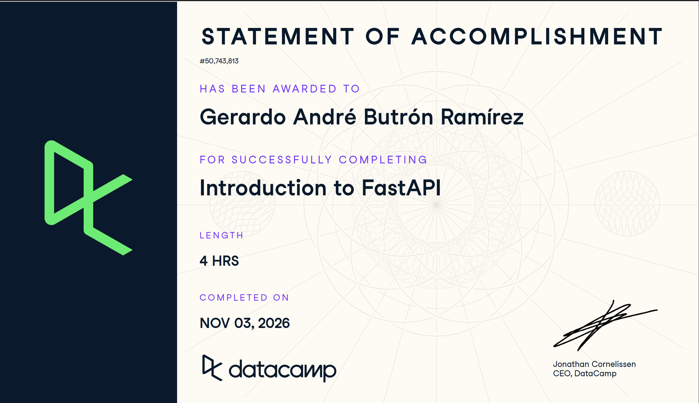

# Certificaciones de FastAPI

Llena este archivo en **tu copia**, dentro de `estudiantes/<tu-login>/fastapi/`.

## Quién soy

- Usuario de GitHub: butronand-png
- Usuario de DataCamp: sin usuario visible en DataCamp; tomé el curso con la cuenta del grupo del ITAM

El repositorio es público: no escribas aquí tu nombre completo ni tu correo.

## Introduction to FastAPI

Fecha en que lo terminaste (AAAA-MM-DD): 2026-11-03

URL del Statement of Accomplishment: https://www.datacamp.com/statement-of-accomplishment/course/8d3634eb112cf795d34339e4c472c39e8d04879b

## Una cosa que aprendiste y no sabías

Que FastAPI valida el cuerpo de una petición contra el modelo de Pydantic antes de correr mi función. Si falta un campo o un tipo no cuadra, contesta solo con un error 422 y un JSON que dice qué campo falló y por qué, sin que yo escriba un solo `if`. Pensaba que esa validación había que programarla a mano en cada endpoint.
