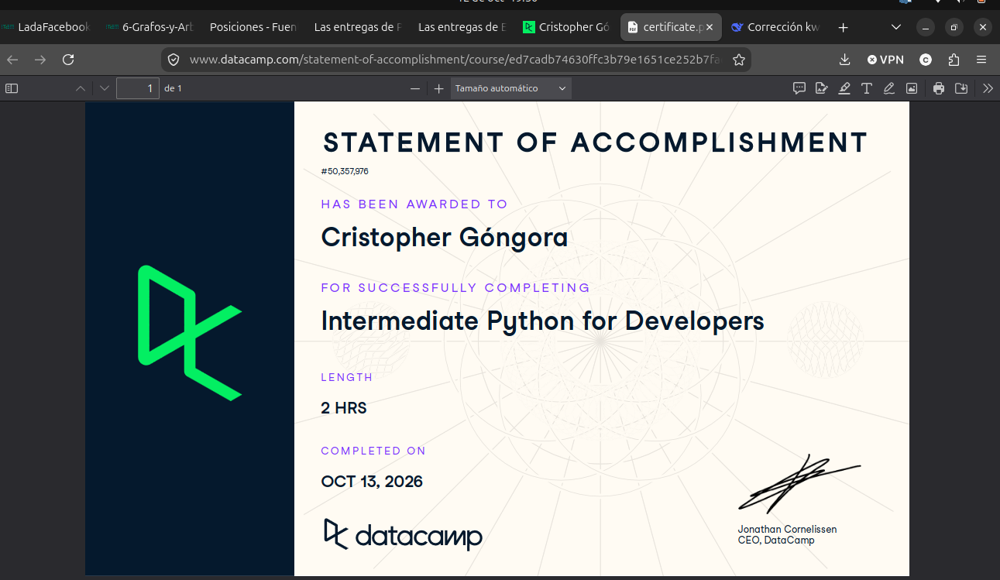

# Certificado: Intermediate Python for Developers

Llena este archivo en **tu copia**, dentro de `estudiantes/<tu-login>/09_python/por_dentro/`.

## Quién soy

- Usuario de GitHub: cristoredentor
- Usuario de DataCamp: Cristopher

El repositorio es público: no escribas aquí tu nombre completo ni tu correo.

## Intermediate Python for Developers

Fecha en que lo terminaste (AAAA-MM-DD): 2026-10-12

URL del Statement of Accomplishment: https://www.datacamp.com/completed/statement-of-accomplishment/course/ed7cadb74630ffc3b79e1651ce252b7fae201857?utm_medium=organic_social&utm_campaign=sharewidget&utm_content=soa

## Una cosa que aprendiste y no sabías

Dos o tres líneas: algo concreto del curso que no sabías, o que tenías a medias
y ahí se te acomodó.

En este curso me quedo más claro el uso de las funciones lambda que no había entendido bien y aprendí a usar argumentos flexibles en las funciones con *args o **kvalues como argumentos.
