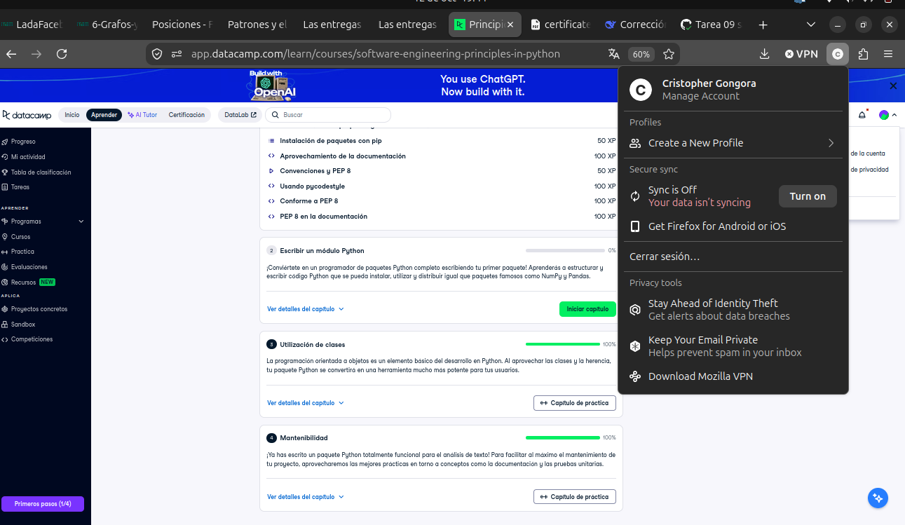

# Certificado: Software Engineering Principles in Python

Llena este archivo en **tu copia**, dentro de `estudiantes/<tu-login>/09_python/stack/`.

## Quién soy

- Usuario de GitHub: cristoredentor
- Usuario de DataCamp: Cristopher

El repositorio es público: no escribas aquí tu nombre completo ni tu correo.

## Software Engineering Principles in Python, capítulos 3 y 4

Fecha en que terminaste el capítulo 4 (AAAA-MM-DD): 2026-10-11

## Una cosa que aprendiste y no sabías

Dos o tres líneas: algo concreto de los capítulos 3 o 4 que no sabías, o que
tenías a medias y ahí se te acomodó.

Tenía a medias como importar con diferentes paquetes en python y aprendí sobre las herramientas de documentación que se pueden usar con python como Docstring o Sphinx
así como herramientas de pruebas como Travis CI.
