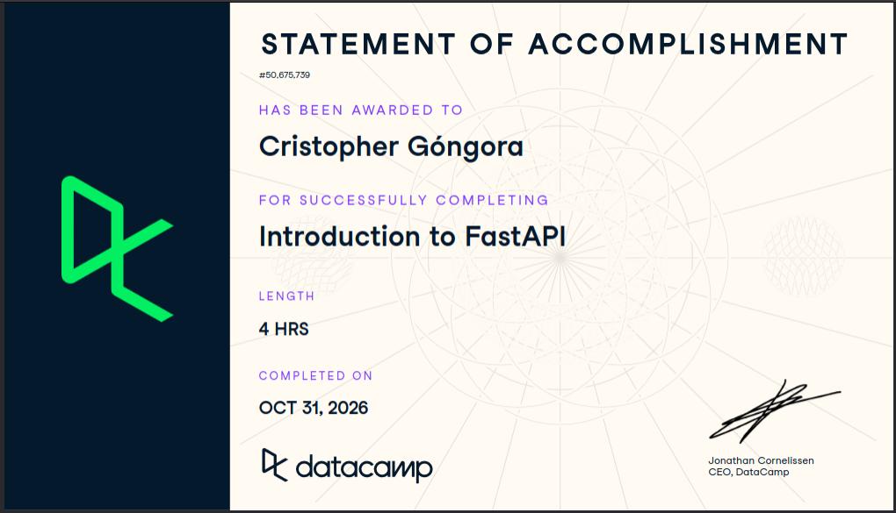

# Certificaciones de FastAPI

Llena este archivo en **tu copia**, dentro de `estudiantes/<tu-login>/fastapi/`.

## Quién soy

- Usuario de GitHub: cristoredentor
- Usuario de DataCamp: Cristopher

El repositorio es público: no escribas aquí tu nombre completo ni tu correo.

## Introduction to FastAPI

Fecha en que lo terminaste (AAAA-MM-DD): 2026-10-31

URL del Statement of Accomplishment: https://www.datacamp.com/completed/statement-of-accomplishment/course/6ba32b27def0ddf2ff52e07ba837adcacf91aded?utm_medium=organic_social&utm_campaign=sharewidget&utm_content=soa

## Una cosa que aprendiste y no sabías

Se llena en esta entrega. Dos o tres líneas: algo concreto del curso que no
sabías, o que tenías a medias y ahí se te acomodó.

En este curso aprendí a usar fastapi de una mejor manera, lo había usado pero nunca combinado con TestClient, también me quedo más claro como funciona un post, get, update y delete y 
me dió una mayor noción de la importancia de pensar en todas las posibles pruebas de tu código como una consulta de und ato después de insertarlo o que no te deje
eliminar un dato que no existe ...
