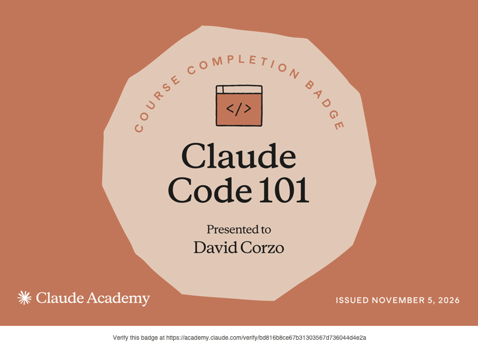

# Certificaciones de Claude Code

Llena este archivo en **tu copia**, dentro de `estudiantes/<tu-login>/claude_code/`.

## Quién soy

- Usuario de GitHub: dacorzo

El repositorio es público: no escribas aquí tu nombre completo ni tu correo.

## Claude Code 101

Fecha en que lo terminaste (AAAA-MM-DD): 2026-11-05

URL del badge de Claude Academy: https://academy.claude.com/verify/bd816b8ce67b31303567d736044d4e2a

Si no terminaste el curso, dilo aquí abajo: qué lecciones o qué parte del
quiz te faltaron. Reportar el pendiente cuenta como entrega.

## Una cosa que aprendiste y no sabías

Se llena en esta entrega. Dos o tres líneas: algo concreto del curso que no
sabías, o que tenías a medias y ahí se te acomodó.
La diferencia entre una skill, CLAUDE.md (tampoco sabía qué era esto) y un hook. De igual manera me hizo más sentido cómo funciona el flujo de CLaude.
