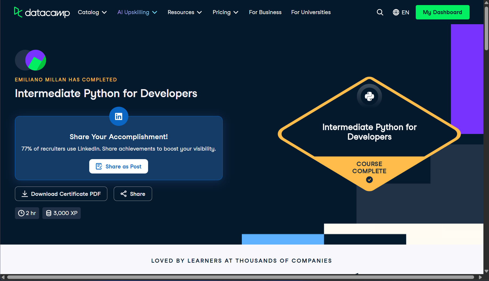

# Certificado: Intermediate Python for Developers

Llena este archivo en **tu copia**, dentro de `estudiantes/<tu-login>/09_python/por_dentro/`.

## Quién soy

- Usuario de GitHub: emilianomillan
- Usuario de DataCamp: Emiliano

El repositorio es público: no escribas aquí tu nombre completo ni tu correo.

## Intermediate Python for Developers

Fecha en que lo terminaste (AAAA-MM-DD): 2026-10-07

URL del Statement of Accomplishment: https://www.datacamp.com/completed/statement-of-accomplishment/course/96a929b62ae1a0f12041875323f12822bdaef3e1

## Una cosa que aprendiste y no sabías

Aprendí las funciones lambda, tanto el concepto por sí solo como su uso en Python, y reforcé los docstrings.