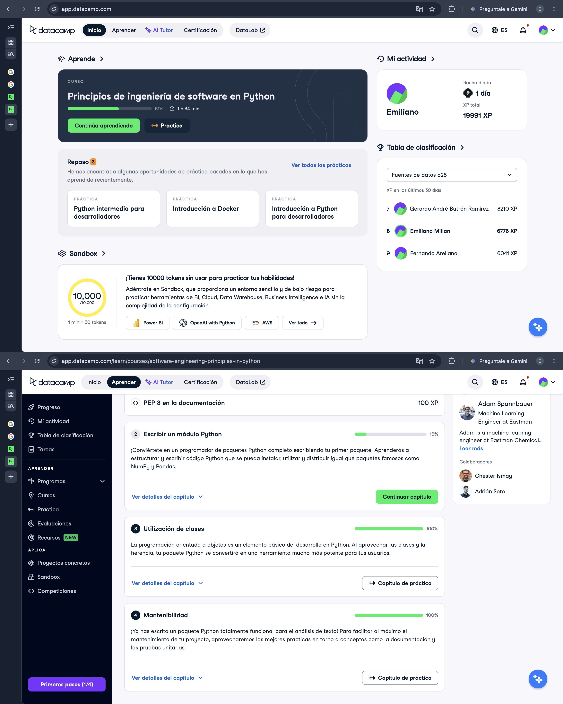

# Certificado: Software Engineering Principles in Python

Llena este archivo en **tu copia**, dentro de `estudiantes/<tu-login>/09_python/stack/`.

## Quién soy

- Usuario de GitHub: emilianomillan
- Usuario de DataCamp: Emiliano

El repositorio es público: no escribas aquí tu nombre completo ni tu correo.

## Software Engineering Principles in Python, capítulos 3 y 4

Fecha en que terminaste el capítulo 4 (AAAA-MM-DD): 2026-10-27

## Una cosa que aprendiste y no sabías

Aprendí qué son los doctest y la importancia de las pruebas unitarias. También que las pruebas se pueden hacer con una función, cuando pensaba que eran más complejas.