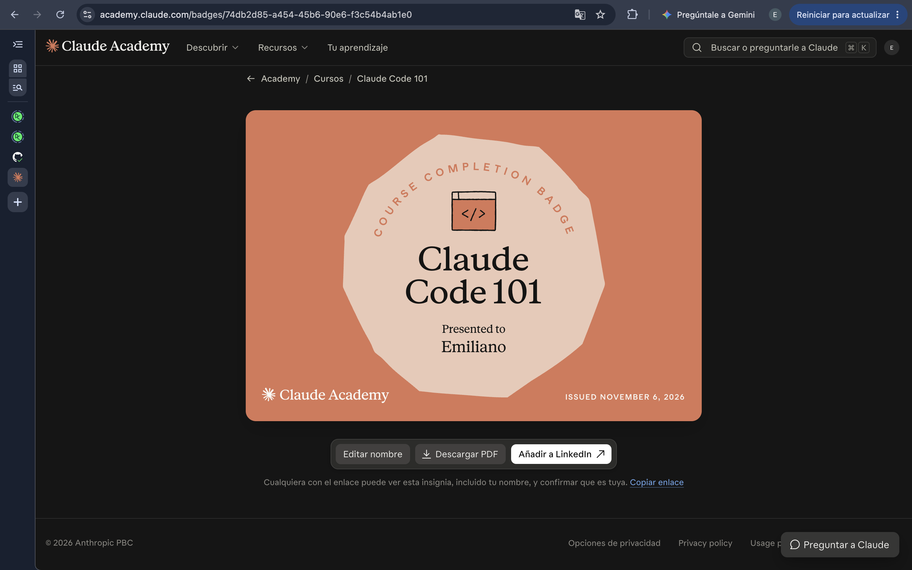

# Certificaciones de Claude Code

Llena este archivo en **tu copia**, dentro de `estudiantes/<tu-login>/claude_code/`.

## Quién soy

- Usuario de GitHub: emilianomillan

El repositorio es público: no escribas aquí tu nombre completo ni tu correo.

## Claude Code 101

Fecha en que lo terminaste (AAAA-MM-DD): 2026-11-06

URL del badge de Claude Academy: No hay link o no encontré una liga que mandara directo al badge

Si no terminaste el curso, dilo aquí abajo: qué lecciones o qué parte del
quiz te faltaron. Reportar el pendiente cuenta como entrega.

## Una cosa que aprendiste y no sabías

Aprendí que el contexto se puede resumir cuando la ventana se llena. También que existe el archivo CLAUDE.md, que me recuerda a lo que me gusta de los projects, que el contexto se queda guardado, y no sabía que había algo igual para Code.
