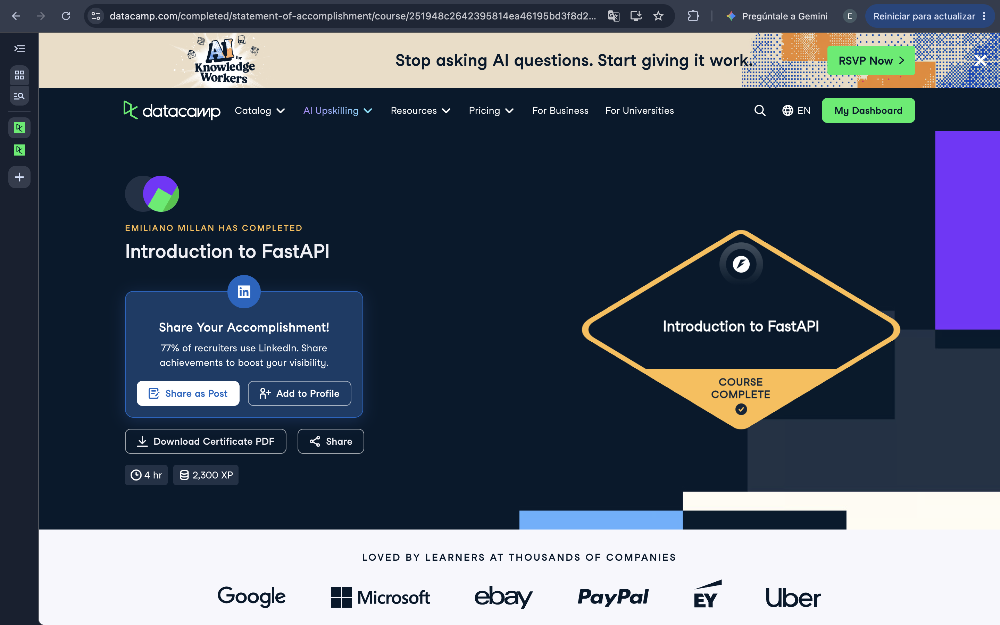

# Certificaciones de FastAPI

Llena este archivo en **tu copia**, dentro de `estudiantes/<tu-login>/fastapi/`.

## Quién soy

- Usuario de GitHub: emilianomillan
- Usuario de DataCamp: Emiliano

El repositorio es público: no escribas aquí tu nombre completo ni tu correo.

## Introduction to FastAPI

Fecha en que lo terminaste (AAAA-MM-DD): 2026-11-03

URL del Statement of Accomplishment: https://www.datacamp.com/completed/statement-of-accomplishment/course/251948c2642395814ea46195bd3f8d25fc7997bf

## Una cosa que aprendiste y no sabías

Aprendí la necesidad de detener el servidor con ctrl c o con pkill. También que existen las pruebas de sistema, solo conocía las unitarias.
