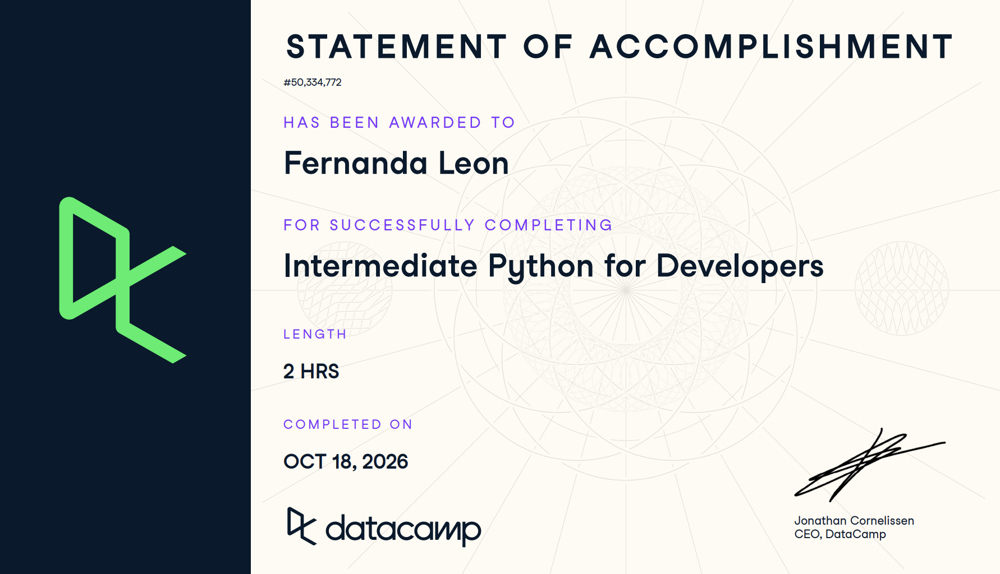

# Certificado: Intermediate Python for Developers

Llena este archivo en **tu copia**, dentro de `estudiantes/<tu-login>/09_python/por_dentro/`.

## Quién soy

- Usuario de GitHub: fernandalh25
- Usuario de DataCamp: Fernanda Leon

El repositorio es público: no escribas aquí tu nombre completo ni tu correo.

## Intermediate Python for Developers

Fecha en que lo terminaste (AAAA-MM-DD): 2026-10-18

URL del Statement of Accomplishment: https://www.datacamp.com/completed/statement-of-accomplishment/course/b959e3bbdc7746f3d93c7fa28c4cb5f2278a6988

## Una cosa que aprendiste y no sabías

Dos o tres líneas: algo concreto del curso que no sabías, o que tenías a medias
y ahí se te acomodó.
Aprendí a diferenciar mejor cuándo usar try-except y cuándo usar raise. Antes los veía casi como lo mismo, pero ahora entiendo que try-except sirve para manejar un error y continuar, mientras que raise se usa para generar un error intencionalmente cuando una condición no es válida.
