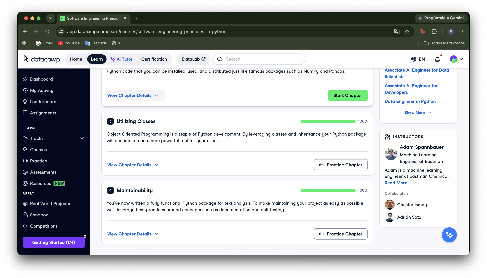

# Certificado: Software Engineering Principles in Python

Llena este archivo en **tu copia**, dentro de `estudiantes/<tu-login>/09_python/stack/`.

## Quién soy

- Usuario de GitHub: fernandalh25
- Usuario de DataCamp: Fernanda León

El repositorio es público: no escribas aquí tu nombre completo ni tu correo.

## Software Engineering Principles in Python, capítulos 3 y 4

Fecha en que terminaste el capítulo 4 (AAAA-MM-DD): 2026-10-26

## Una cosa que aprendiste y no sabías
Aprendí a usar la herencia para extender la funcionalidad de una clase sin duplicar código, siguiendo el principio DRY. También entendí mejor cómo super() permite reutilizar la inicialización y los métodos de las clases padre cuando se trabaja con distintos niveles de herencia.
