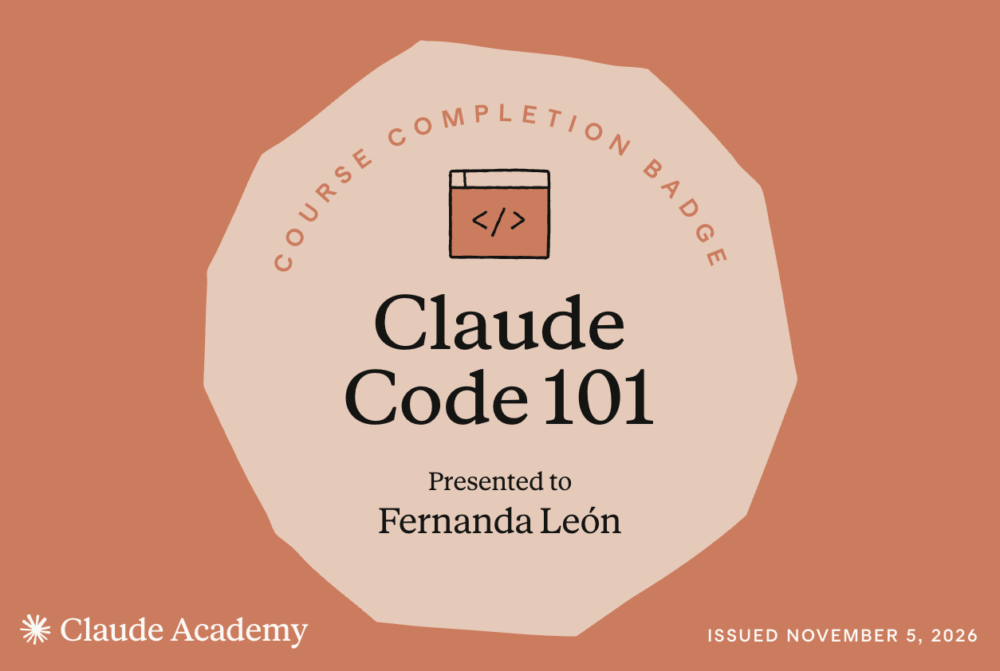

# Certificaciones de Claude Code

Llena este archivo en **tu copia**, dentro de `estudiantes/<tu-login>/claude_code/`.

## Quién soy

- Usuario de GitHub: fernandalh25

El repositorio es público: no escribas aquí tu nombre completo ni tu correo.

## Claude Code 101

Fecha en que lo terminaste (AAAA-MM-DD): 2026-11-05

URL del badge de Claude Academy:https://academy.claude.com/verify/e91825639500618c1d3918dde89bd0ba

Si no terminaste el curso, dilo aquí abajo: qué lecciones o qué parte del
quiz te faltaron. Reportar el pendiente cuenta como entrega.

## Una cosa que aprendiste y no sabías

Aprendí a utilizar los distintos modos de Claude Code y entendí mejor la importancia de explorar y planificar antes de modificar archivos. También me quedó más claro cómo funciona la ventana de contexto, su compactación automática y el uso de `CLAUDE.md` para mantener instrucciones específicas de un proyecto.
