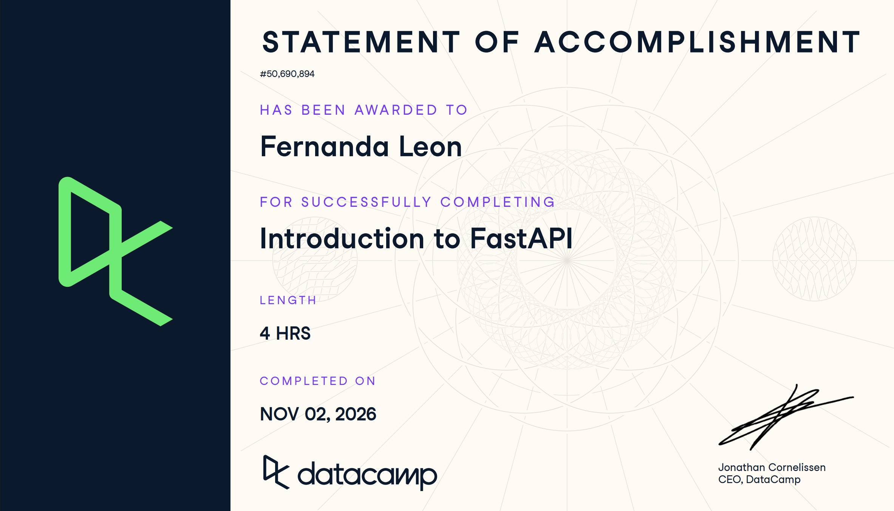

# Certificaciones de FastAPI

Llena este archivo en **tu copia**, dentro de `estudiantes/<tu-login>/fastapi/`.

## Quién soy

- Usuario de GitHub: fernandalh25
- Usuario de DataCamp: Fernanda León

El repositorio es público: no escribas aquí tu nombre completo ni tu correo.

## Introduction to FastAPI

Fecha en que lo terminaste (AAAA-MM-DD): 2026-11-01

URL del Statement of Accomplishment: https://www.datacamp.com/completed/statement-of-accomplishment/course/30ede86c6aebcb6bce328778c2dbaec6267d4cd7?utm_medium=organic_social&utm_campaign=sharewidget&utm_content=soa

## Una cosa que aprendiste y no sabías

Aprendí que async es útil cuando una API tiene que esperar respuestas de otros sistemas, como una base de datos o una API externa. Mientras una tarea espera, FastAPI puede atender otras solicitudes de forma concurrente, en lugar de dejar ese tiempo sin aprovechar.
