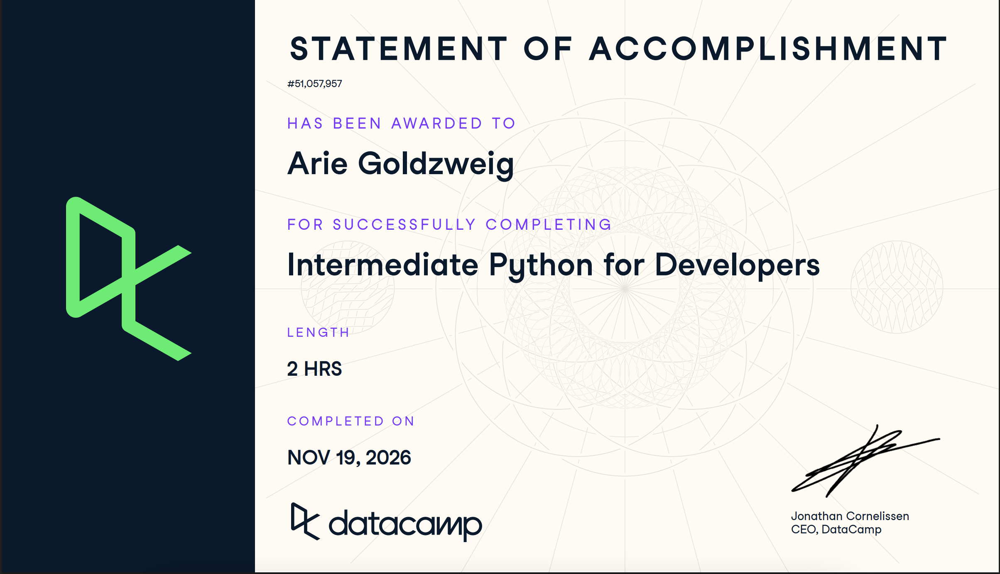

# Certificado: Intermediate Python for Developers

Llena este archivo en **tu copia**, dentro de `estudiantes/<tu-login>/09_python/por_dentro/`.

## Quién soy

- Usuario de GitHub: goldzweigarie-bit
- Usuario de DataCamp: Arie G

El repositorio es público: no escribas aquí tu nombre completo ni tu correo.

## Intermediate Python for Developers

Fecha en que lo terminaste (AAAA-MM-DD): 2026-11-19

URL del Statement of Accomplishment: https://www.datacamp.com/completed/statement-of-accomplishment/course/d4f9d826bc8ad44f56b82eaf44da6c1bbd0228a6

## Una cosa que aprendiste y no sabías

Aprendí a usar `*args` y `**kwargs`: con `*args` una función recibe cualquier número de argumentos posicionales como una tupla, y con `**kwargs` los argumentos con nombre como un diccionario. No sabía que así se pueden escribir funciones que aceptan entradas variables sin definir cada parámetro, y que también sirven al revés, para desempacar una lista o un diccionario al llamar una función.
