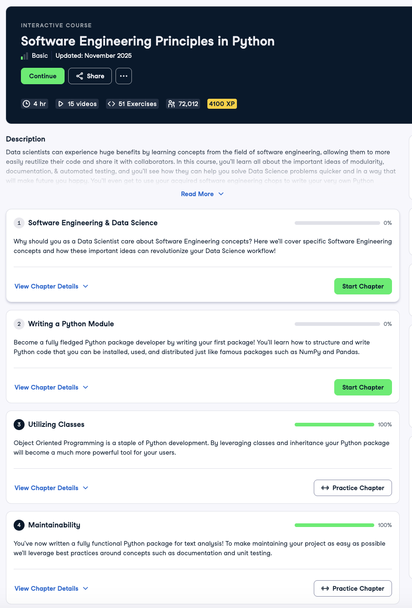

# Certificado: Software Engineering Principles in Python

Llena este archivo en **tu copia**, dentro de `estudiantes/<tu-login>/09_python/stack/`.

## Quién soy

- Usuario de GitHub: goldzweigarie-bit
- Usuario de DataCamp: Arie G

El repositorio es público: no escribas aquí tu nombre completo ni tu correo.

## Software Engineering Principles in Python, capítulos 3 y 4

Fecha en que terminaste el capítulo 4 (AAAA-MM-DD): 2026-11-19

## Una cosa que aprendiste y no sabías

Pendiente: la lleno cuando termine los capítulos 3 y 4.
