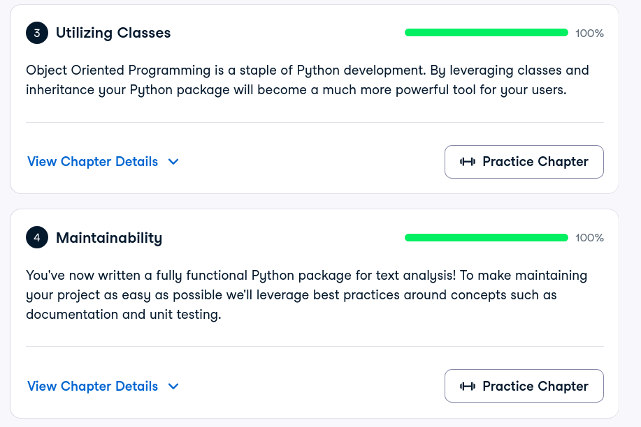

# Certificado: Software Engineering Principles in Python

## Quién soy

- Usuario de GitHub:jpmedinae
- Usuario de DataCamp:jpmedinae

## Software Engineering Principles in Python, capítulos 3 y 4

Fecha en que terminaste el capítulo 4 (AAAA-MM-DD):2026-10-12

## Una cosa que aprendiste y no sabías

Aprendí a aplicar la programación orientada a objetos en Python: clases, herencia, etc. Además, ya sé cómo documentar varias cosas.

