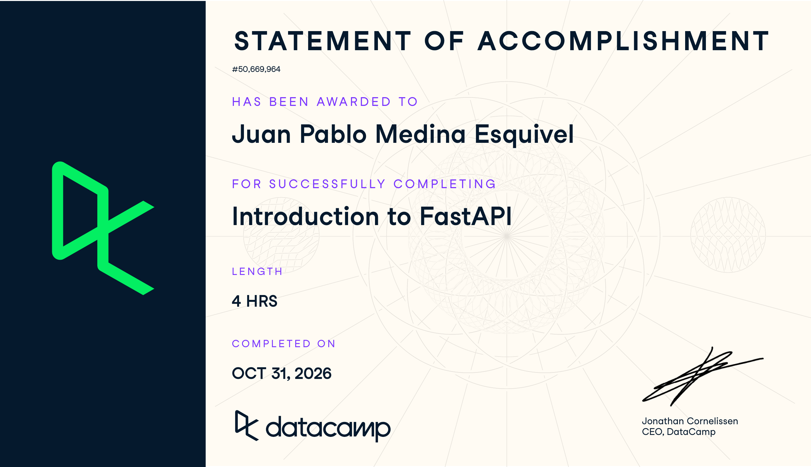

# Certificaciones de FastAPI

Llena este archivo en **tu copia**, dentro de `estudiantes/<tu-login>/fastapi/`.

## Quién soy

- Usuario de GitHub:jpmedinae
- Usuario de DataCamp:jpmedinae

El repositorio es público: no escribas aquí tu nombre completo ni tu correo.

## Introduction to FastAPI

Fecha en que lo terminaste (AAAA-MM-DD):2026-10-31

URL del Statement of Accomplishment:https://www.datacamp.com/statement-of-accomplishment/course/d298ce5e73e1fd701bd821509d1c1953c4a382b6?raw=1

## Una cosa que aprendiste y no sabías

Aprendí a crear rutas en FastAPI utilizando decoradores como @app.get() y @app.post(). También aprendí a utilizar modelos de Pydantic para validar automáticamente los datos recibidos en las peticiones.
