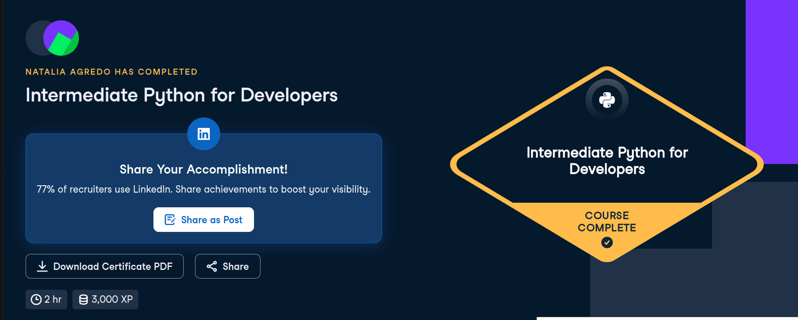

# Certificado: Intermediate Python for Developers

Llena este archivo en **tu copia**, dentro de `estudiantes/<tu-login>/09_python/por_dentro/`.

## Quién soy

- Usuario de GitHub:nat-aglo
- Usuario de DataCamp:Natalia Agredo

El repositorio es público: no escribas aquí tu nombre completo ni tu correo.

## Intermediate Python for Developers

Fecha en que lo terminaste (AAAA-MM-DD):2026-10-13

URL del Statement of Accomplishment:https://www.datacamp.com/completed/statement-of-accomplishment/course/d95f1b79b9556f8a641730d493e27452ad9db6bb

## Una cosa que aprendiste y no sabías

Dos o tres líneas: algo concreto del curso que no sabías, o que tenías a medias
y ahí se te acomodó.
No sabia nada de pandas. Aun si no lo recomienda, es bueno conocer .DataFrame() para formato tipo tabla o .read_csv(). Ya sabia igual agregar
comentarios pero no Docstrings, bastante util y sencillo. Lo que mas me intereso fueron los arbitrary arguments, es como al Object o args de 
java pero con asterisco.
