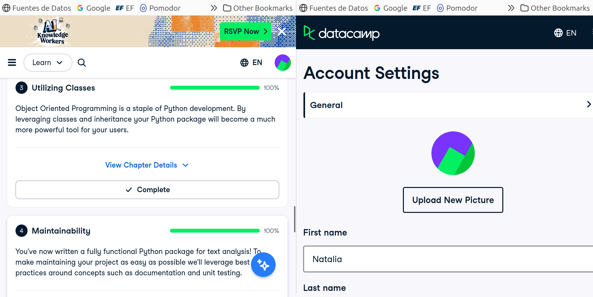

# Certificado: Software Engineering Principles in Python

Llena este archivo en **tu copia**, dentro de `estudiantes/<tu-login>/09_python/stack/`.

## Quién soy

- Usuario de GitHub: nat-aglo
- Usuario de DataCamp: Natalia

El repositorio es público: no escribas aquí tu nombre completo ni tu correo.

## Software Engineering Principles in Python, capítulos 3 y 4

Fecha en que terminaste el capítulo 4 (AAAA-MM-DD): 2026-10-13

## Una cosa que aprendiste y no sabías

Dos o tres líneas: algo concreto de los capítulos 3 o 4 que no sabías, o que
tenías a medias y ahí se te acomodó.
Ya habia usado un poco clases en python (aprendi a programar en java, asi que la estructura se me hacia conocida) pero no la logica interna.
Me agrado conocer en principio DRY y como heredar clases (atributos, metodos). Igual me gusto aprender a documentar(Docstrings) y la
documentacion de clases. Me parecio mas facil que en java. 
