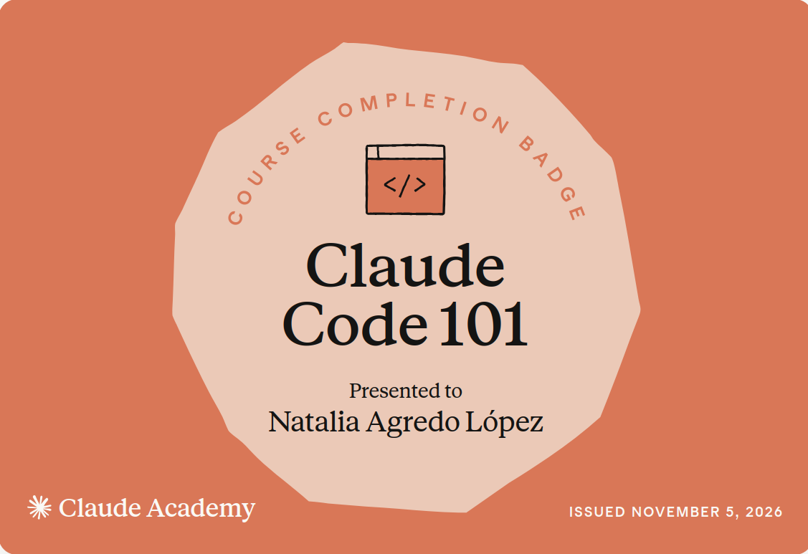

# Certificaciones de Claude Code

Llena este archivo en **tu copia**, dentro de `estudiantes/<tu-login>/claude_code/`.

## Quién soy

- Usuario de GitHub: nat-aglo

El repositorio es público: no escribas aquí tu nombre completo ni tu correo.

## Claude Code 101

Fecha en que lo terminaste (AAAA-MM-DD): 2026-11-05

URL del badge de Claude Academy: https://academy.claude.com/verify/5d2467f352ef10f4c81509841fc49d7e

Si no terminaste el curso, dilo aquí abajo: qué lecciones o qué parte del
quiz te faltaron. Reportar el pendiente cuenta como entrega.

## Una cosa que aprendiste y no sabías

Se llena en esta entrega. Dos o tres líneas: algo concreto del curso que no
sabías, o que tenías a medias y ahí se te acomodó.
Incluso en uno de los quizzes me recomendo checarlo: subagentes y CLAUDE.md (me parece que los equivalentes en Antigravity es GEMINI.md & AGENTS.md). Es bueno saber como agregar instrucciones que se voy a necesitar constantemente. Igual ya conocia que eran los subagents y cuando usarlos (mas o menos), pero no como. Igual toca checar si agy tiene tambien los suyos.
 
