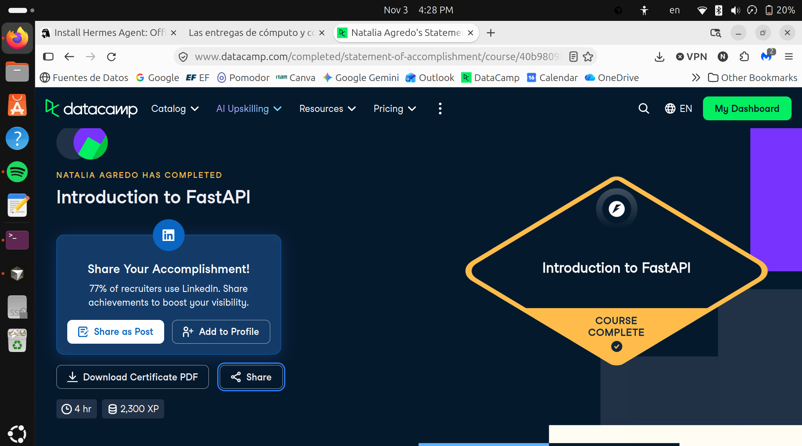

# Certificaciones de FastAPI

Llena este archivo en **tu copia**, dentro de `estudiantes/<tu-login>/fastapi/`.

## Quién soy

- Usuario de GitHub: nat-aglo
- Usuario de DataCamp: Natalia Agredo

El repositorio es público: no escribas aquí tu nombre completo ni tu correo.

## Introduction to FastAPI

Fecha en que lo terminaste (AAAA-MM-DD): 2026-11-03

URL del Statement of Accomplishment: https://www.datacamp.com/completed/statement-of-accomplishment/course/40b9809f98cd7822c12a97333703548e50d5401c?utm_medium=organic_social&utm_campaign=sharewidget&utm_content=soa

## Una cosa que aprendiste y no sabías

Se llena en esta entrega. Dos o tres líneas: algo concreto del curso que no
sabías, o que tenías a medias y ahí se te acomodó.

No sabia mucho de FastAPI en general, fuera de lo que ocupe para bases de datos. Lo que mas me llamo la atencion fueron los tests automaticos.
Igual la parte de concurrencia con async no lo habia escuchado, y entiendo que solo se usa con operaciones que utilicen await. Me gustaria 
usarlo en alguna practica para ver que diferencia hace, pues por lo que entendi se usa para aprovechar tiempos de espera en I/O y que el servidor
no se quede varado mientras espera respuesta (ej. bases de datos).
