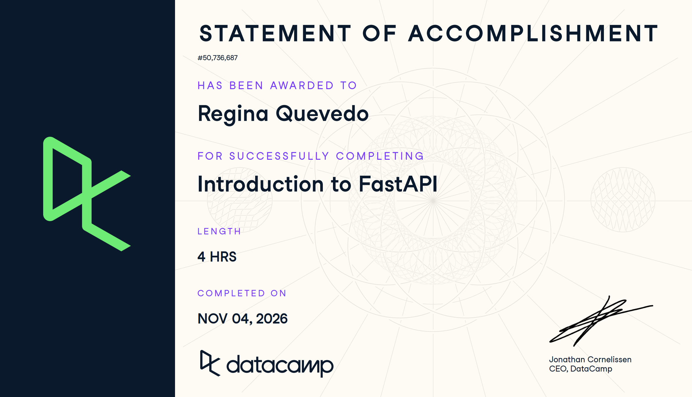

# Certificaciones de FastAPI

Llena este archivo en **tu copia**, dentro de `estudiantes/<tu-login>/fastapi/`.

## Quién soy

- Usuario de GitHub: reginaquevedo
- Usuario de DataCamp:Regina

El repositorio es público: no escribas aquí tu nombre completo ni tu correo.

## Introduction to FastAPI

Fecha en que lo terminaste (AAAA-MM-DD):2026-11-03

URL del Statement of Accomplishment: https://www.datacamp.com/completed/statement-of-accomplishment/course/bafe28bb3e67046f78fd149a633fcef2a4fc8a1f

## Una cosa que aprendiste y no sabías

Que FastAPI arma sola una página de documentación en /docs donde puedes probar la API sin escribir código.
La diferencia entre un GET (pedir información) y un POST (mandar información nueva).
Que con Pydantic defines cómo deben verse los datos y FastAPI rechaza solo lo que no cumple.
